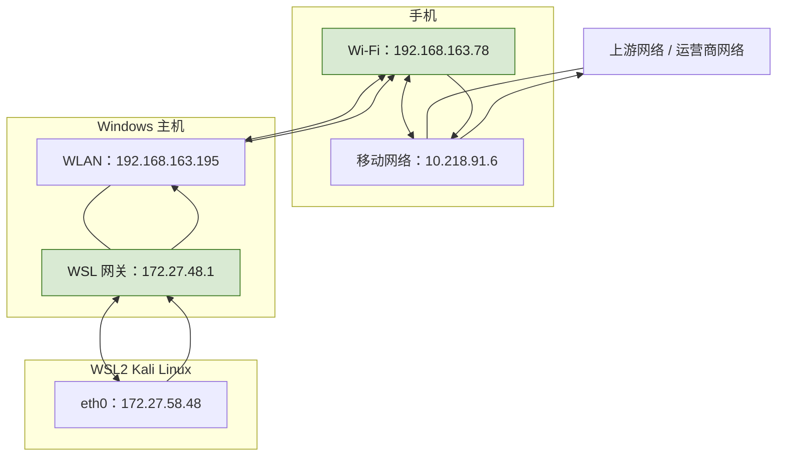

# WSL2 通过手机网关访问网络

## 1. 网络拓扑



**网络路径：**

```text
Kali → WSL2 网关 → Windows → 手机 Wi-Fi → 手机移动网络 → Internet
```

## 2. 实验信息

| 设备 / 接口  | IP 地址           | 作用               |
| ------------ | ----------------- | ------------------ |
| Kali eth0    | `172.27.58.48`    | WSL2 虚拟机地址    |
| Windows WSL  | `172.27.48.1`     | WSL2 默认网关      |
| Windows WLAN | `192.168.163.195` | Windows 局域网地址 |
| 手机 Wi-Fi   | `192.168.163.78`  | Windows 默认网关   |
| 手机移动网络 | `10.218.91.6`     | 手机移动网络地址   |

## 3. 命令与作用

| 命令                                     | 获取的信息                            |
| ---------------------------------------- | ------------------------------------- |
| `ip addr`                                | 查看 Kali 网卡、IP、MAC 地址          |
| `ip route`                               | 查看 Kali 路由表和默认网关            |
| `ip route get 10.218.91.6`               | 查看 Kali 访问目标时选择的路由        |
| `ip neigh`                               | 查看 Kali 邻居设备的 IP 与 MAC 映射   |
| `ping 10.218.91.6`                       | 验证 Kali 与手机移动网络地址的连通性  |
| `nmap -Pn --top-ports 100 10.218.91.6`   | 探测目标常用 TCP 端口                 |
| `Test-NetConnection 10.218.91.6`         | 查看 Windows 到目标的连通性及路由选择 |
| `tracert -d 10.218.91.6`                 | 查看 Windows 到目标的路由跃点         |
| `Get-NetRoute -AddressFamily IPv4`       | 查看 Windows IPv4 路由表              |
| `Get-Service WslService, vmcompute, hns` | 检查 WSL 虚拟化及网络管理服务         |

## 4. 实验结论

1. Kali 运行在 WSL2 中，通过 `172.27.48.1` 访问外部网络
2. Windows WLAN 地址为 `192.168.163.195`，默认网关为 `192.168.163.78`
3. `192.168.163.78` 是手机的 Wi-Fi 地址，手机同时拥有移动网络地址 `10.218.91.6`
4. Windows 可以通过手机访问 `10.218.91.6`，Kali 也能与该地址通信

**核心结论：** 手机充当当前局域网的默认网关，Windows 的默认流量交由手机处理，Kali 则通过 WSL2 和 Windows 的网络路径间接访问手机。

> 注：实验验证了路由选择和连通性；完整的 NAT 转换过程及运营商侧网络路径尚未通过抓包验证。