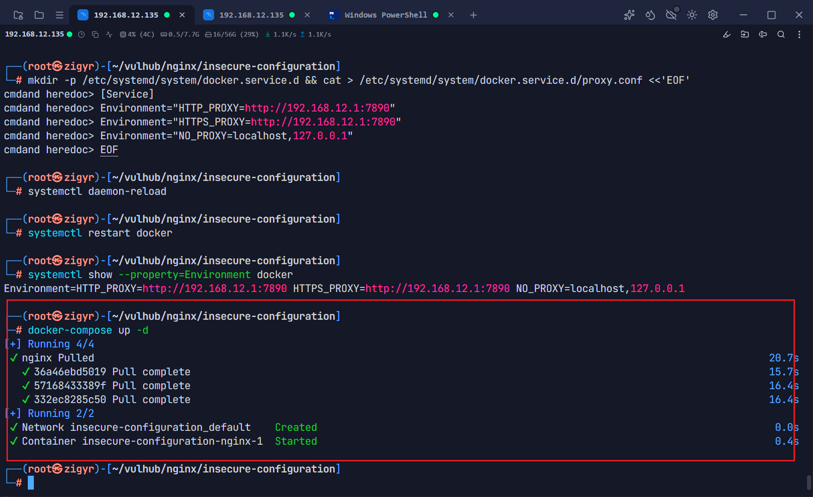

# Docker - Kali 安装与基础配置

## 速查

**安装 Docker：**

```shell
# 更新软件包索引
apt update

# 安装 Docker 和 Docker Compose
apt install docker.io docker-compose

# 启动 Docker 并设置开机自启
systemctl enable --now docker
```

**验证安装：**

```shell
# 查看 Docker 版本
docker version

# 查看 Docker Compose 版本
docker-compose version

# 查看 Docker 运行信息
docker info

# 测试 Docker 是否正常运行
docker run hello-world
```

**核心配置：**

| 配置        | 文件 / 命令                                       | 作用                   |
| ----------- | ------------------------------------------------- | ---------------------- |
| Shell 代理  | `export http_proxy=...`                           | 当前 Shell 及子进程    |
| APT 代理    | `/etc/apt/apt.conf.d/99proxy`                     | APT 软件包下载         |
| Docker 代理 | `/etc/systemd/system/docker.service.d/proxy.conf` | Docker Daemon 网络请求 |

**核心认识：** Docker 镜像拉取由 Docker Daemon 负责，因此 Shell 能够访问互联网，不代表 Docker 一定能够正常拉取镜像

## 一、Docker 安装

### 1. 安装 Docker

Kali 可以直接通过 APT 安装 Docker：

```shell
# 更新软件包索引
apt update

# 安装 Docker 和 Docker Compose
apt install docker.io docker-compose
```

启动 Docker：

```shell
# 启动 Docker
systemctl start docker

# 设置开机自启
systemctl enable docker

# 查看运行状态
systemctl status docker
```

> 也可以合并为：`systemctl enable --now docker`

### 2. 验证安装

```shell
# 查看 Docker 版本
docker version

# 查看 Docker Compose 版本
docker-compose version

# 查看 Docker 运行信息
docker info

# 测试 Docker 是否正常运行
docker run hello-world
```

> `hello-world` 会自动拉取测试镜像并创建容器。如果能够正常输出欢迎信息，说明 Docker 基本运行正常

## 二、代理配置

在 Kali 虚拟机中使用 Docker 时，可能遇到网络连接问题

例如：

```
Get "https://registry-1.docker.io/v2/":
context deadline exceeded
```

这是 Docker 连接 Docker Hub 超时，通常需要检查代理配置

### 1. 为 Kali 配置临时代理

首先，在 Windows 的 Clash 中开启**允许局域网连接（Allow LAN）**

通过 Windows `ipconfig` 查看 VMware 网卡 IP，例如：

```
VMware Network Adapter VMnet8:

IPv4 地址：192.168.12.1
```

在 Kali 中配置代理：

```
export http_proxy="http://192.168.12.1:7890"
export https_proxy="http://192.168.12.1:7890"
```

验证：

```
curl -I https://www.google.com
```

### 2. 为 APT 单独配置代理

仅配置环境变量不一定能保证 APT 按预期使用代理，因此可以单独配置 APT

创建配置文件：

```
cat > /etc/apt/apt.conf.d/99proxy <<'EOF'
Acquire::http::Proxy "http://192.168.12.1:7890/";
Acquire::https::Proxy "http://192.168.12.1:7890/";
EOF
```

验证：

```
apt-config dump | grep -i proxy
```

如果输出了刚才配置的代理地址，说明 APT 已加载代理配置

### 3. 为 Docker Daemon 配置代理

这是 Docker 镜像拉取时需要重点关注的配置

Docker Daemon 是 Docker 的后台服务进程，负责镜像拉取、容器管理等工作

因此，即使 Kali 中的 `curl` 能够通过代理访问互联网，也不代表 Docker Daemon 已经使用代理

创建 systemd 配置目录和代理文件：

```
mkdir -p /etc/systemd/system/docker.service.d

cat > /etc/systemd/system/docker.service.d/proxy.conf <<'EOF'
[Service]
Environment="HTTP_PROXY=http://192.168.12.1:7890"
Environment="HTTPS_PROXY=http://192.168.12.1:7890"
Environment="NO_PROXY=localhost,127.0.0.1,::1"
EOF
```

重新加载 systemd 配置并重启 Docker：

```
# 重新加载 systemd 配置
systemctl daemon-reload

# 重启 Docker
systemctl restart docker
```

验证 Docker 是否加载代理：

```
systemctl show --property=Environment docker
```

预期能够看到类似输出：

```
Environment=HTTP_PROXY=http://192.168.12.1:7890
HTTPS_PROXY=http://192.168.12.1:7890
NO_PROXY=localhost,127.0.0.1,::1
```

> **注意：** Docker Daemon 的代理主要作用于 Daemon 自身发起的网络请求，不代表容器内部的网络流量也会自动经过代理

## 三、安装过程中遇到的问题

### 1. APT 下载软件包出现 404

**问题表现：**

执行 `apt install docker.io` 时，部分软件包下载失败：

```
错误：无法下载 ... 404 Not Found

错误：有几个软件包无法下载，
要不运行 apt update 或者加上 --fix-missing 的选项再试试？
```

**原因：**

Kali Rolling 是滚动更新发行版，软件包版本会持续变化。

1. 本地 APT 索引记录了旧版本软件包。
2. Kali 软件源更新，旧版本 `.deb` 文件可能被替换或移除。
3. APT 根据旧索引下载软件包，服务器返回 `404 Not Found`。

**解决方法：**

```
apt update
apt install docker.io docker-compose
```

如果仍然出现 404，可能是镜像站同步尚未完成，可以稍后重试或更换软件源

### 2. APT 下载速度很慢

**问题表现：**

虽然已经配置 Kali 环境变量代理，下载速度仍然很慢：

```
92% [2 docker-cli 2,476 kB/8,260 kB 30%]
[1 containerd 26.2 MB/29.5 MB 89%]
147 kB/s
```

**原因分析：**

`curl` 能够通过代理访问互联网，不代表 APT 一定使用了代理

可能的原因：

1. APT 没有正确使用代理
2. 当前 Clash 节点速度较慢
3. Kali 软件源本身下载速度较慢

**排查与解决：**

```
# 查看 APT 是否配置代理
apt-config dump | grep -i proxy
```

如果没有输出，说明没有显式配置 APT 代理，可以参考前面的 APT 独立代理配置

### 3. Docker 拉取镜像超时

**问题表现：**

```
Get "https://registry-1.docker.io/v2/":
context deadline exceeded
```

**原因分析：**

Docker Daemon 连接 Docker Hub 时超时

Shell 环境变量代理和 APT 代理不会自动成为 Docker Daemon 的代理配置

**排查与解决：**

```
# 验证 Docker 是否加载代理
systemctl show --property=Environment docker
```

如果没有输出，说明没有为 Docker Daemon 配置代理，可以参考前面的 Docker Daemon 代理配置

## 四、本次安装总结

这次在 Kali 中安装 Docker，整体流程比较简单：

```
更新 APT 索引
      |
      v
安装 docker.io 和 docker-compose
      |
      v
启动 Docker 服务
      |
      v
配置 Docker Daemon 代理
      |
      v
拉取镜像
      |
      v
docker-compose up -d
      |
      v
启动漏洞环境
```

本次主要遇到两个问题：

1. 安装 Docker 时，Kali Rolling 软件源索引与镜像站实际文件不同步，导致部分软件包出现 404
2. Docker 拉取镜像时无法正常连接 Docker Hub，通过为 Docker Daemon 配置 Clash 代理解决

相比以前折腾 Docker 镜像源的方式，这次直接利用 Windows 上的 Clash 作为统一代理出口，不需要额外配置 Docker 镜像加速站

**这次方案的核心就是：**

- Kali 环境变量代理：解决普通命令行程序的网络访问
- APT 独立代理：解决软件包下载
- Docker Daemon 代理：解决 Docker 镜像拉取

整个方案比较简单，适合自己日常在 Kali 中搭建 Vulhub 等 Docker 靶场时使用
