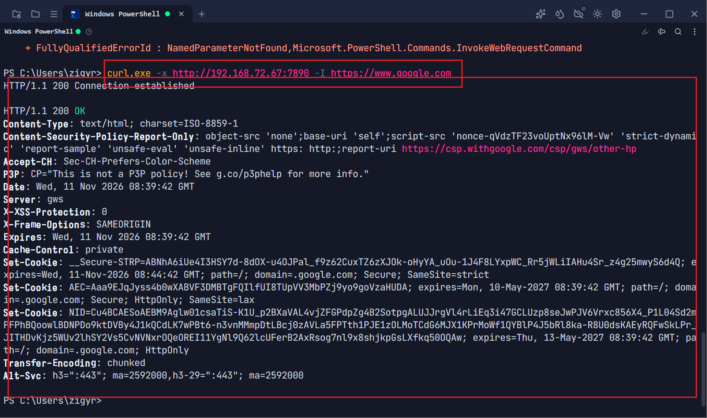
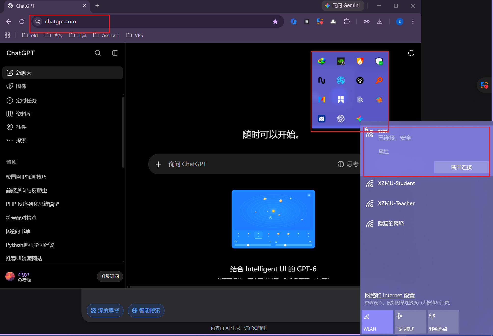

### 在手机端配置代理

> 代理客户端：[Clash Android 下载 | APK 安装包与客户端选择 | Clash 官网](https://clashapp.org/zh-CN/clash-download/android.html)
>
> 机场：https://www.zou999.com/#/register?code=JXOnDaLw

开启**允许来自局域网的连接**

### 在电脑端配置伪代理

`ipconfig`

获得 **无线局域网适配器 WLAN**

看到 默认网关 192.168.72.67

即当前局域网下手机 IP

clash 常见端口是 7890

随后手动配置电脑的代理 `192.168.72.67:7890`

> ### 为 NAT 模式的 kali 配置代理
>
> ```shell
> export http_proxy="http://192.168.72.67:7890"
> export https_proxy="http://192.168.72.67:7890"
> 
> export HTTP_PROXY="$http_proxy"
> export HTTPS_PROXY="$https_proxy"
> ```

### 使用测试

连通性测试：`ping 192.168.72.67`

测试代理端口：`Test-NetConnection 192.168.72.67 -Port 7890`

再用代理直接请求 Google：`curl -x http://192.168.72.67:7890 -I https://www.google.com`



随后，也是在电脑端没有任何代理配置的情况下，成功访问 chatgpt

google 搜索也 ouk


gemini 也能跑

手机端切换节点到新加坡，也是访问刚刚地区限制的网页了

### 更进一步

每次连完热点后，还得手动看 IP 配代理，麻烦

下面是一个 bat 脚本，连接好热点后，自己探测 IP，自己配置代理

双击 bat 脚本：

- `1. Enable Phone Proxy`：自动获取手机热点网关，检测代理端口并开启 Windows 系统代理
- `2. Disable System Proxy`：关闭 Windows 系统代理，恢复普通网络访问
- `3. Show Proxy Status`：查看当前系统代理的启用状态及代理服务器地址
- `4. Test Proxy Connection`：测试电脑与手机代理服务器之间的 TCP 端口连通性
- `0. Exit`：退出 Proxy Manager

```cmd

@echo off
setlocal EnableExtensions
title Proxy Manager

set "PORT=7890"
set "REGKEY=HKCU\Software\Microsoft\Windows\CurrentVersion\Internet Settings"

:MENU
cls
echo ========================================
echo             Proxy Manager
echo ========================================
echo.
echo   1. Enable Phone Proxy
echo   2. Disable System Proxy
echo   3. Show Proxy Status
echo   4. Test Proxy Connection
echo   0. Exit
echo.
echo ========================================
set /p "choice=Select: "

if "%choice%"=="1" goto ENABLE
if "%choice%"=="2" goto DISABLE
if "%choice%"=="3" goto STATUS
if "%choice%"=="4" goto TEST
if "%choice%"=="0" exit
goto MENU


:GET_GATEWAY
set "GATEWAY="

for /f "usebackq delims=" %%A in (`powershell -NoProfile -Command "Get-NetIPConfiguration | Where-Object { $_.NetAdapter.Status -eq 'Up' -and $_.IPv4DefaultGateway } | Where-Object { $_.InterfaceAlias -match 'Wi-Fi|WLAN|Wireless|无线' } | Select-Object -First 1 -ExpandProperty IPv4DefaultGateway | Select-Object -ExpandProperty NextHop"`) do (
    set "GATEWAY=%%A"
)

if not defined GATEWAY (
    echo [!] Wi-Fi gateway not found.
    exit /b 1
)

echo [*] Detected gateway: %GATEWAY%
exit /b 0


:ENABLE
cls
echo [*] Detecting gateway...

call :GET_GATEWAY
if errorlevel 1 (
    pause
    goto MENU
)

set "PROXY=%GATEWAY%:%PORT%"

echo.
echo [*] Proxy: %PROXY%
echo [*] Testing proxy port...

powershell -NoProfile -Command "$r=Test-NetConnection '%GATEWAY%' -Port %PORT% -WarningAction SilentlyContinue; exit [int](-not $r.TcpTestSucceeded)"

if errorlevel 1 (
    echo.
    echo [!] Proxy connection failed.
    echo [!] Check Clash LAN access and port 7890.
    pause
    goto MENU
)

reg add "%REGKEY%" /v ProxyServer /t REG_SZ /d "http=%PROXY%;https=%PROXY%" /f >nul
if errorlevel 1 (
    echo [!] Failed to configure ProxyServer.
    pause
    goto MENU
)

reg add "%REGKEY%" /v ProxyOverride /t REG_SZ /d "<local>;localhost;127.0.0.1" /f >nul
reg add "%REGKEY%" /v ProxyEnable /t REG_DWORD /d 1 /f >nul

echo.
echo [OK] System proxy enabled.
echo [OK] Proxy: %PROXY%
pause
goto MENU


:DISABLE
cls
reg add "%REGKEY%" /v ProxyEnable /t REG_DWORD /d 0 /f >nul

echo.
echo [OK] System proxy disabled.
pause
goto MENU


:STATUS
cls
echo ========== Proxy Status ==========
reg query "%REGKEY%" /v ProxyEnable
reg query "%REGKEY%" /v ProxyServer
echo =================================
pause
goto MENU


:TEST
cls
call :GET_GATEWAY

if errorlevel 1 (
    pause
    goto MENU
)

echo.
echo [*] Testing %GATEWAY%:%PORT%
echo.

powershell -NoProfile -Command "Test-NetConnection '%GATEWAY%' -Port %PORT%"

pause
goto MENU
```

